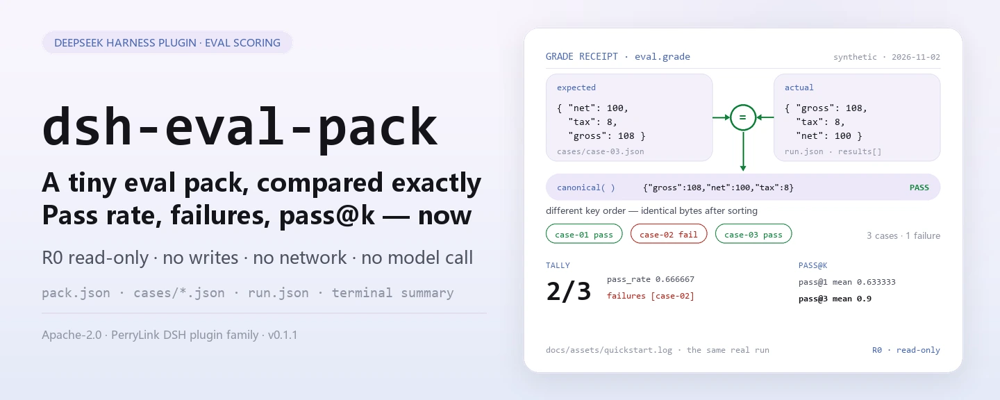

<div align="center">

<picture>
  <source media="(prefers-color-scheme: dark)" srcset="docs/assets/dsh-eval-pack-hero-en-dark.webp">
  
</picture>

# dsh-eval-pack

**Compare a small eval pack case by case with exact JSON equality and get the pass rate, the failing ids, and pass@k on the spot.**

A purely local scoring toolkit for DeepSeek Harness: lint the pack structure, grade with deterministic JSON equality, summarize one run, and estimate unbiased pass@k — all four tools are read-only, with no network, no model call, and no upload.

[Install](#three-step-setup) · [Configuration](#configuration) · [FAQ](#faq) · [简体中文](README.md) · [English](README.en.md) · [Español](README.es.md) · [Português](README.pt.md) · [हिन्दी](README.hi.md)

[](LICENSE)
[](#compatibility)
[](https://www.npmjs.com/package/dsh-eval-pack)
[](https://github.com/PerryLink/dsh-eval-pack/actions/workflows/ci.yml)
[](#compatibility)

[](https://github.com/PerryLink/dsh-eval-pack/stargazers)
[](https://www.npmjs.com/package/dsh-eval-pack)
[](https://dshfind.com/plugins/PerryLink/dsh-eval-pack?ref=badge)
[](https://dsh.market/)
[](https://gitee.com/perrylink/dsh-eval-pack)

```sh
dsh plugin --profile <profile> add dsh-eval-pack
```

</div>

<sub>Community plugin, not affiliated with DeepSeek. Canonical repository: <https://github.com/PerryLink/dsh-eval-pack> (Gitee is a mirror). Status: alpha · verified on public/synthetic data only · not GA — no customer data or customer evidence, no production-readiness claim.</sub>

## What it is

It does one thing: compare a small eval pack case by case with exact JSON equality and report the pass rate, the failing ids, and pass@k. `eval_pack_lint` checks the pack itself (`name`, `version`, unique task ids), `eval_grade` performs canonical JSON equality grading, `eval_summary` folds one run into a pass rate plus a failure list, and `eval_pass_at_k` estimates `1 - C(n-c, k) / C(n, k)`. All four tools are pure functions and fully read-only: no file writes, no network, no model call; inputs are read by the session and passed in as arguments, and the original files are never touched.

- **Good fit**: reviewing the pass rate of a small eval pack (3–50 cases) where deterministic JSON equality is required and fuzzy matching is not acceptable.
- **Not a fit**: scenarios that need a model call, subjective scoring, or a real benchmark run — this package only grades and summarizes; it never runs the system under test.

<picture>
  <source media="(prefers-color-scheme: dark)" srcset="docs/assets/dsh-eval-pack-flow-v5-dark.svg">
  
</picture>

## Three-step setup

1. **Install** (pick one channel):

   ```sh
   # npm channel (recommended; published releases)
   dsh plugin --profile <profile> add dsh-eval-pack
   # git channel (latest main; equivalent to git+https://github.com/PerryLink/dsh-eval-pack.git)
   dsh plugin --profile <profile> add github:PerryLink/dsh-eval-pack
   # tarball channel: pnpm pack in this repo, then
   dsh plugin --profile <profile> add ./dsh-eval-pack-<version>.tgz
   ```

2. **Minimal config** (the install command already applies the bundle patch; hand-written profiles paste this one row):

   ```yaml
   - insert:
       - id: dsh-eval-pack
         name: dsh-eval-pack
   ```

   The plugin has no plugin-level config keys; everything tunable lives in the tool arguments — see "Configuration".

3. **Verify it mounts**:

   ```sh
   dsh --profile <profile> --dump-config | grep dsh-eval-pack
   ```

   A synthetic sample ships with the repo. `lib/` is a build artifact and is not committed, so build once first (it should end with `quickstart ok`):

   ```sh
   pnpm install --frozen-lockfile && pnpm build
   node samples/quickstart/run.mjs --check
   ```

Inside a session you can also just ask for it — the demo prompt shipped in `package.json` as `dsh.demo.prompt`:

```text
我用自带样例跑一次评测：3 个样本里过了几个、哪个没过、pass@3 是多少？
```

**Uninstall**: `dsh plugin --profile <profile> remove dsh-eval-pack` (or remove the row from the profile patch).

<details>
<summary>Install from the DSH Desktop market</summary>

Every PerryLink plugin is listed in the built-in DSH Desktop market: **Market → Sources → Add source → paste** `https://perrylink-dsh-catalog.perrylink.workers.dev/catalog-source.json` **→ select**. Installation still requires the market's npm identity check and your confirmation.

</details>

## Core capabilities

- **Pack-structure lint** — `eval_pack_lint` checks `name`, `version`, a non-empty `tasks` list, and unique task ids, returning `ok` plus an error-code array; it runs no evaluation.
- **Deterministic JSON grading** — `eval_grade` first canonicalizes both sides into a stable form (object keys sorted, arrays kept in order) and compares the serializations byte for byte: key order does not matter, while array order, numeric precision, and string case are compared as-is.
- **One-run summary** — `eval_summary` reports `total`, `passed`, `failed`, `pass_rate` (six decimals), and the failing task ids, using the same grading ruler.
- **Unbiased pass@k** — `eval_pass_at_k` computes `1 - C(n-c, k) / C(n, k)` with exact BigInt binomials and returns a per-task `pass_at_k` plus the mean; `k > samples` and `correct > samples` fail loudly.
- **Purely local, read-only** — all four tools are marked **R0**: no file writes, no config changes, no HTTP / DNS / WebSocket calls in the source, and no model call.

### Tool surface

Tool names are a stable API; all four tools are R0 read-only. Names use only ASCII letters, digits and underscores, matching the provider's `^[a-zA-Z0-9_-]+$` check on `tools[].name`.

| Tool | Purpose | Risk |
|---|---|---|
| `eval_pack_lint` | Validate `name` / `version` / non-empty `tasks` and unique task ids | R0 read-only |
| `eval_grade` | Deterministic JSON equality grade for one task | R0 read-only |
| `eval_summary` | Summarize one run: pass count, pass rate, failing task ids | R0 read-only |
| `eval_pass_at_k` | Unbiased pass@k and its mean from sampling counts | R0 read-only |

### Input and output

Input:

- `pack.json`: `name`, `version`, and `tasks` (the list of task ids); `tasks` must not be empty and every id must be unique.
- One JSON per case: `id`, `prompt`, `expected`; grading only looks at `expected` and at the run result's `actual`.
- `run.json`: one run's results in `results[].actual`, plus the `sampling[]` entries (`samples` / `correct`) used by pass@k.
- The shipped sample lives in `samples/quickstart/input/`: three case JSONs plus one run result, far below 500 KB in total. There is no hard size cap; keep a single JSON ≤1 MB — the sample is just the smallest reproducible set.

Output:

- A terminal summary: whether lint passed, each case's pass/fail, the pass rate with failing ids, and pass@1 plus pass@3.
- No files are written; when you need a record, redirect the `--json` output to a file of your own.

### Examples

The quickstart sample (synthetic, shipped with the package; run `pnpm build` first):

```sh
node samples/quickstart/run.mjs          # human-readable summary
node samples/quickstart/run.mjs --json   # canonical result — the source of the expected/result.json gold file
node samples/quickstart/run.mjs --check  # recompute and diff against the gold file, ending with quickstart ok
```

Real run output (`docs/assets/quickstart.log`, run on 2026-11-02):

```text
$ node samples/quickstart/run.mjs
dsh-eval-pack quickstart - synthetic eval pack (not a benchmark)
pack synthetic-invoice-basics@1.0.0: lint ok, 3 tasks
grades: case-01 pass, case-02 fail, case-03 pass
summary: 2/3 passed (0.666667), failures: case-02
pass@1 mean 0.633333; pass@3 mean 0.9
```


*Synthetic sample → gold file `samples/quickstart/expected/result.json`; the command, timestamp, and output hashes are recorded in `screenshots.json` (`run_at` 2026-11-02T22:15:29+08:00, `output_sha256` starting with `2ba7ea50…`).*

Public/synthetic acceptance: re-run `node scripts/acceptance.mjs`; the rows are in `ACCEPTANCE.csv` (the `script` and `evidence_sha256` columns are omitted here):

| req_id | metric | threshold | actual | pass | source | counted |
|---|---|---|---|---|---|---|
| EVAL-A01 | valid pack accepted | 1/1 | true | true | public/synthetic | false |
| EVAL-A02 | duplicate task ids rejected | 1/1 | true | true | public/synthetic | false |
| EVAL-A03 | deterministic grade | 1/1 | true | true | public/synthetic | false |
| EVAL-A04 | canonical grading ignores key order | 1/1 | true | true | public/synthetic | false |
| EVAL-A05 | array order still matters | 1/1 | true | true | public/synthetic | false |
| EVAL-A06 | run summary pass rate | 1/1 | true | true | public/synthetic | false |
| EVAL-A07 | pass@k estimator | 1/1 | true | true | public/synthetic | false |
| PS1-QS01 | quickstart sample matches the gold file | 1/1 | 1 | true | synthetic/quickstart | true |

*The EVAL rows are public/synthetic fixture checks (`counted=false`); PS1-QS01 is a local reproduction of the shipped sample (`counted=true`). None is a customer run, and no output is invented.*

## Configuration

This plugin has no Schemastery `Config` keys — `cordis.patch.yml` only `insert`s one row (see "Three-step setup"), so there is no plugin-level key to override. Everything tunable lives in the tool arguments and the input JSON fields:

| Input | Fields | Meaning |
|---|---|---|
| `pack.json` | `name` / `version` / `tasks[].id` | Pack identity plus the task-id list; `tasks` must not be empty and ids must be unique |
| `cases/<id>.json` | `id` / `prompt` / `expected` | Each case's prompt and gold answer; grading only uses `expected` and the run result's `actual` |
| `run.json` | `results[].id` / `results[].actual` | One run's actual outputs, aligned to the cases by `id` |
| `run.json` | `sampling[].task_id` / `samples` / `correct` | Sampling counts for pass@k; requires `0 ≤ correct ≤ samples` |

Tool arguments (all required; invalid values fail loudly):

| Argument | Tool | Constraint | Meaning |
|---|---|---|---|
| `pack` | `eval_pack_lint` | a JSON object | The whole eval-pack object |
| `actual` / `expected` | `eval_grade` | any JSON | The two sides of the canonical comparison |
| `results[]` | `eval_summary` | each item has `id` / `actual` / `expected` | One run's per-case results |
| `k` / `tasks[]` | `eval_pass_at_k` | `1 ≤ k ≤ samples`; `0 ≤ correct ≤ samples` | Sampling statistics and the `k` of pass@k |

> Grading rule: key order does not matter, array order does, and numbers must be exactly equal; `pass_rate` and `pass_at_k` are both rounded to six decimals (`0.666667`).

## FAQ

<details>
<summary>Install fails — what now?</summary>

Confirm DSH `>=0.2.1-rc.3 <0.4.0` and Node `>=24.9 <25`, then retry with a fresh `DSH_HOME`; the full steps are in [TROUBLESHOOTING.md](TROUBLESHOOTING.md).

</details>

<details>
<summary>Two JSON files look identical — why did the case fail?</summary>

Grading canonicalizes first: object key order does not matter, but array order, numeric precision, and string case are compared as-is — `12.34` and `12.35` are not equal, and neither are `[1, 2]` and `[2, 1]`.

</details>

<details>
<summary>How is pass@k computed?</summary>

With the unbiased estimator `1 - C(n-c, k) / C(n, k)`, where `n` is the sampling count per task and `c` the number of correct samples; binomials are exact via BigInt. `k` may not exceed `n`, and `correct` may not exceed `samples` — otherwise the call fails with `E_EVAL_K` / `E_EVAL_CORRECT`.

</details>

<details>
<summary>Can it process my real eval set?</summary>

It runs locally, but the package is alpha and verified only on public/synthetic eval packs — it is not a benchmark conclusion. Sanitize real data before use and keep a human reviewer in the loop.

</details>

<details>
<summary>Does it make network calls or invoke a model?</summary>

No. Lint, grading, and summarization all run on your machine: the four tools are pure functions, the source contains no HTTP / DNS / WebSocket calls, and no model is called.

</details>

## Security boundaries

- **Read-only.** All four tools only return objects: no file writes, no config changes, no mutation of the input JSON. When you need a record, redirect the returned value or the `--json` output into a file of your own.
- **No network, no model call.** Unless a tool explicitly says so, there is no network or model call; `src/core/harness.ts` holds pure functions only, and input and output stay local.
- **Deterministic grading.** Canonical serialization plus byte-for-byte comparison: the same input always yields the same verdict — no randomness, no model variance.
- **Loud failures.** Invalid input (a pack missing `name` / `version`, empty `tasks`, duplicate task ids, a non-positive-integer sampling count, `correct > samples`, `k > samples`) throws at call time, in one uniform format — a plain one-line message, an `E_XXX` code, and the next step. Symptom/cause/action for all nine codes are in [TROUBLESHOOTING.md](TROUBLESHOOTING.md).
- **No runner.** It grades and summarizes only: no model call, no benchmark run, and no assumption about the system under test.

## Permissions & data

- **Reads**: the eval-pack JSON, case JSONs, and run-result JSON you point at (read by the session and passed in as arguments); no other directories.
- **Writes**: none (all four tools are read-only and write no files).
- **Network**: no (no HTTP / DNS / WebSocket calls in the source).
- **External systems**: none (no model call, no eval-platform connection, no upload).
- **Data boundary**: verified on public/synthetic samples only; no customer data, no customer evidence.

## Known limitations

- **Verified on public/synthetic data only.** Every EVAL-A01…A07 row in `ACCEPTANCE.csv` is `counted=false` (public/synthetic fixtures); only PS1-QS01 is a local reproduction of the shipped sample (`counted=true`). No customer data or customer evidence.
- **Alpha / partial / not counted / not GA.** No production-readiness claim; not a benchmark conclusion.
- **Grading only, no runner.** No model call, no real evaluation run, no subjective scoring, and no generation or repair of the system's output.
- **JSON equality, not semantic equality.** Key order is ignored, but array order, numeric precision, and string case are compared as-is; handle semantic comparison inside your own pipeline.
- **pass@k depends on sampling data.** `k` may not exceed a task's `samples`, and `correct` may not exceed `samples`; when tasks have different sampling counts, take the minimum first and use one shared `k`.
- **Input must be UTF-8 JSON.** A UTF-8 BOM makes the parser fail on the first key; strip the BOM.

## Compatibility

| Surface | Status |
|---|---|
| Harness | DeepSeek Harness `>=0.2.1-rc.3 <0.4.0` (`engines.dsh` in `package.json`) |
| Node | `>=24.9.0 <25` (`engines.node` in `package.json`) |
| Platforms | Anywhere DSH runs; local files only |
| Data | No network, no model call, no upload |

## Ecosystem & quality

- [Gitee mirror](https://gitee.com/perrylink/dsh-eval-pack) (sync mirror; GitHub is canonical)
- [dshfind plugin page](https://dshfind.com/plugins/PerryLink/dsh-eval-pack) (installs and ranking)
- [DSH Market](https://dsh.market/) (listed)
- **1024 store channel**: `npm i -g dsh1024` once, then `dsh1024 plugin --profile <profile> add dsh-eval-pack` (counts toward the [deepseek1024.com](https://deepseek1024.com) install ranking)
- [Domain index](https://perrylink.github.io/dsh-plugins/) · [Checker family](https://perrylink.github.io/zh/checkers/) · [Mainline family](https://github.com/PerryLink/dsh-kit)
- [Troubleshooting](TROUBLESHOOTING.md)

### Related work and checkers

Sibling packages and family indexes: [dsh-policy-ledger](https://github.com/PerryLink/dsh-policy-ledger) · [dsh-pim-lint](https://github.com/PerryLink/dsh-pim-lint)

Each companion package is a separate package with its own tool surface and version; install only the ones you need:

| Package | Why it is relevant |
|---|---|
| [`dsh-score`](https://github.com/PerryLink/dsh-score) | Scoring and evaluation utilities. |
| [`dsh-doublecheck`](https://github.com/PerryLink/dsh-doublecheck) | Requirements / test / adversary quality gate. |
| [`dsh-test-drive`](https://github.com/PerryLink/dsh-test-drive) | Test-driving workflows and CI checks. |

## Development

```sh
pnpm install --frozen-lockfile                             # node >=24.9 <25
pnpm build && pnpm lint && pnpm typecheck && pnpm test      # tsc build + lint + 15 node --test cases
pnpm gate                                                   # acceptance gate: re-runs scripts/acceptance.mjs and validates ACCEPTANCE.csv row shape
node samples/quickstart/run.mjs --check                     # synthetic sample, should print quickstart ok
```

Current version `0.2.0` (matches `package.json`). Tests: `node --test test/*.test.mjs` all green (6 test files, 15 cases; `pnpm test` builds first). `lib/` is the tsc build output and is not committed (`.gitignore`), so run `pnpm build` before the sample or the tests.

| Directory | Contents |
|---|---|
| `src/core/harness.ts` | Pure functions for lint / canonicalization / grading / summary / pass@k, plus the nine error codes |
| `src/plugin/` | Cordis plugin entry (`inject: ['tools']`) and the `defineTool` declarations of the four tools |
| `test/` | `node --test`: 6 files, 15 cases |
| `samples/quickstart/` | Synthetic eval pack (3 cases + run result + gold file) and the re-runnable `run.mjs` |
| `scripts/` | `acceptance.mjs` (acceptance re-run), `gate.mjs` (gate), `lint.mjs`, `check-npm-name.mjs`, `gen-readme-assets.py` (README images) |
| `docs/assets/` | Hero banners (four webp files), the structure diagram (light/dark SVG pair) and the real run screenshot |

The README images are generated programmatically by [`scripts/gen-readme-assets.py`](scripts/gen-readme-assets.py) (Python: Pillow draws the four hero banners `hero-{zh,en}-{light,dark}.webp`; the `flow-v5-{light,dark}.svg` structure diagram is hand-written SVG, light/dark, shared by all five languages) and are safe to re-run: `python scripts/gen-readme-assets.py`.

Topics: `deepseek-harness`, `dsh`, `dsh-plugin`, `eval`, `harness`, `perrylink`, `testing`

## Family & thanks

This project is part of the DeepSeek Harness plugin family from [PerryLink](https://github.com/PerryLink) (all Apache-2.0). If it is useful, **a star helps the next person find it** — nothing is gated behind it.

- [@PerryLink](https://github.com/PerryLink) — creator and maintainer: the pure-function core for pack lint / deterministic grading / summary / pass@k, the four `eval_*` tools, the quickstart synthetic sample and acceptance suite, and the five-language docs.

## License

[LICENSE](LICENSE) (Apache License 2.0) © 2026 PerryLink; see also `NOTICE`.

<p align="center"><sub>Apache-2.0 · Community plugin, not affiliated with DeepSeek.</sub></p>
