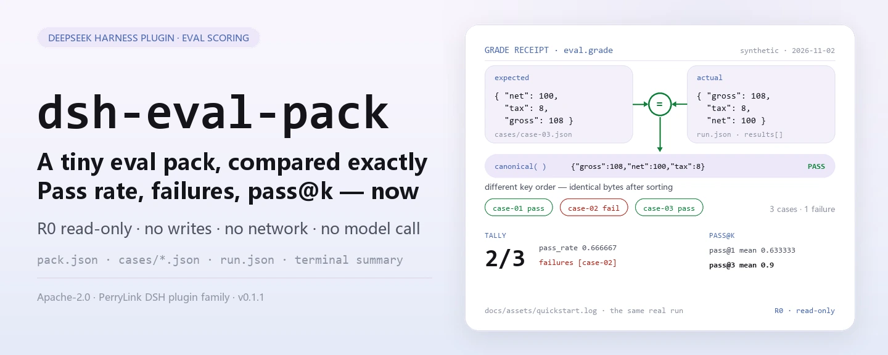

<div align="center">

<picture>
  <source media="(prefers-color-scheme: dark)" srcset="docs/assets/dsh-eval-pack-hero-en-dark.webp">
  
</picture>

# dsh-eval-pack

**Compara un paquete de evaluación pequeño caso por caso con igualdad JSON exacta y obtén en el acto la tasa de aprobación, los ids fallidos y el pass@k.**

Un conjunto de herramientas de puntuación totalmente local para DeepSeek Harness: lint de la estructura del paquete, calificación determinista por igualdad JSON, resumen de una ejecución y estimación insesgada de pass@k — las cuatro herramientas son de solo lectura, sin red, sin llamadas a un modelo y sin subidas.

[Instalar](#instalación-en-tres-pasos) · [Configuración](#configuración) · [FAQ](#faq) · [简体中文](README.md) · [English](README.en.md) · [Español](README.es.md) · [Português](README.pt.md) · [हिन्दी](README.hi.md)

[](LICENSE)
[](#compatibilidad)
[](https://www.npmjs.com/package/dsh-eval-pack)
[](https://github.com/PerryLink/dsh-eval-pack/actions/workflows/ci.yml)
[](#compatibilidad)

[](https://github.com/PerryLink/dsh-eval-pack/stargazers)
[](https://www.npmjs.com/package/dsh-eval-pack)
[](https://dshfind.com/plugins/PerryLink/dsh-eval-pack?ref=badge)
[](https://dsh.market/)
[](https://gitee.com/perrylink/dsh-eval-pack)

```sh
dsh plugin --profile <profile> add dsh-eval-pack
```

</div>

<sub>Plugin de la comunidad, no afiliado a DeepSeek. Repositorio canónico: <https://github.com/PerryLink/dsh-eval-pack> (Gitee es un espejo). Estado: alpha · verificado solo con datos públicos/sintéticos · no GA — sin datos ni evidencia de clientes, sin promesa de producción.</sub>

## Qué es

Hace una sola cosa: compara un paquete de evaluación pequeño caso por caso con igualdad JSON exacta y devuelve la tasa de aprobación, los ids fallidos y el pass@k. `eval.pack_lint` revisa el paquete (`name`, `version`, ids de tarea únicos), `eval.grade` califica por igualdad JSON canónica, `eval.summary` condensa una ejecución en tasa de aprobación y lista de fallos, y `eval.pass_at_k` estima `1 - C(n-c, k) / C(n, k)`. Las cuatro herramientas son funciones puras y totalmente de solo lectura: no escriben archivos, no usan la red y no llaman a un modelo; las entradas las lee la sesión y se pasan como argumentos, y los archivos originales no se tocan.

- **Adecuado para**: revisar la tasa de aprobación de un paquete pequeño (3–50 casos) donde se exige igualdad JSON determinista y no se acepta coincidencia difusa.
- **No adecuado para**: escenarios que necesitan llamadas a un modelo, puntuación subjetiva o un benchmark real — este paquete solo califica y resume; nunca ejecuta el sistema bajo prueba.

<picture>
  <source media="(prefers-color-scheme: dark)" srcset="docs/assets/dsh-eval-pack-flow-v5-dark.svg">
  
</picture>

## Instalación en tres pasos

1. **Instalar** (elige un canal):

   ```sh
   # canal npm (recomendado; versiones publicadas)
   dsh plugin --profile <profile> add dsh-eval-pack
   # canal git (último main; equivalente a git+https://github.com/PerryLink/dsh-eval-pack.git)
   dsh plugin --profile <profile> add github:PerryLink/dsh-eval-pack
   # canal tarball: pnpm pack en este repo, luego
   dsh plugin --profile <profile> add ./dsh-eval-pack-<version>.tgz
   ```

2. **Configuración mínima** (el comando de instalación ya aplica el bundle patch; los perfiles escritos a mano pegan esta única fila):

   ```yaml
   - insert:
       - id: dsh-eval-pack
         name: dsh-eval-pack
   ```

   El plugin no tiene claves de configuración propias; todo lo ajustable está en los argumentos de las herramientas — ver «Configuración».

3. **Verificar que se monta**:

   ```sh
   dsh --profile <profile> --dump-config | grep dsh-eval-pack
   ```

   El repo incluye una muestra sintética. `lib/` es un artefacto de compilación y no se versiona, así que compila primero (debe terminar con `quickstart ok`):

   ```sh
   pnpm install --frozen-lockfile && pnpm build
   node samples/quickstart/run.mjs --check
   ```

   Dentro de una sesión también basta con pedirlo — prompt de demostración incluido en `package.json` como `dsh.demo.prompt`:

   ```text
   我用自带样例跑一次评测：3 个样本里过了几个、哪个没过、pass@3 是多少？
   ```

**Desinstalar**: `dsh plugin --profile <profile> remove dsh-eval-pack` (o quita la fila del patch del perfil).

<details>
<summary>Instalar desde el mercado de DSH Desktop</summary>

Todos los plugins de PerryLink están en el mercado integrado de DSH Desktop: **Market → Sources → Add source → pega** `https://perrylink-dsh-catalog.perrylink.workers.dev/catalog-source.json` **→ selecciona**. La instalación sigue requiriendo la verificación de identidad npm del mercado y tu confirmación.

</details>

## Capacidades clave

- **Lint de la estructura del paquete** — `eval.pack_lint` revisa `name`, `version`, un `tasks` no vacío y la unicidad de los ids de tarea, y devuelve `ok` más un array de códigos de error; no ejecuta ninguna evaluación.
- **Calificación JSON determinista** — `eval.grade` primero canonicaliza ambos lados (claves de objeto ordenadas, arrays en su orden) y compara las serializaciones byte a byte: el orden de las claves da igual, mientras que el orden de los arrays, la precisión numérica y las mayúsculas de las cadenas se comparan tal cual.
- **Resumen de una ejecución** — `eval.summary` informa `total`, `passed`, `failed`, `pass_rate` (seis decimales) y los ids de tarea fallidos, con la misma regla de calificación.
- **pass@k insesgado** — `eval.pass_at_k` calcula `1 - C(n-c, k) / C(n, k)` con binomios exactos vía BigInt y devuelve el `pass_at_k` por tarea más la media; `k > samples` y `correct > samples` fallan en voz alta.
- **Puramente local y de solo lectura** — las cuatro herramientas están marcadas **R0**: sin escrituras de archivos, sin cambios de configuración, sin llamadas HTTP / DNS / WebSocket en el código y sin llamadas a un modelo.

### Superficie de herramientas

Los nombres de las herramientas son una API estable; las cuatro son R0 de solo lectura.

| Herramienta | Propósito | Riesgo |
|---|---|---|
| `eval.pack_lint` | Validar `name` / `version` / `tasks` no vacío e ids de tarea únicos | R0 solo lectura |
| `eval.grade` | Calificación determinista por igualdad JSON de una tarea | R0 solo lectura |
| `eval.summary` | Resumir una ejecución: aprobados, tasa de aprobación, ids fallidos | R0 solo lectura |
| `eval.pass_at_k` | pass@k insesgado y su media a partir de los conteos de muestreo | R0 solo lectura |

### Entrada y salida

Entrada:

- `pack.json`: `name`, `version` y `tasks` (lista de ids de tarea); `tasks` no puede estar vacío y cada id debe ser único.
- Un JSON por caso: `id`, `prompt`, `expected`; la calificación solo mira `expected` y el `actual` del resultado de la ejecución.
- `run.json`: los resultados de una ejecución en `results[].actual`, más las entradas `sampling[]` (`samples` / `correct`) que usa pass@k.
- La muestra incluida está en `samples/quickstart/input/`: tres JSON de caso y un resultado de ejecución, muy por debajo de 500 KB en total. No hay tope duro de tamaño; mantén cada JSON ≤1 MB — la muestra es solo el conjunto mínimo reproducible.

Salida:

- Resumen en terminal: si el lint pasó, el pass/fail de cada caso, la tasa de aprobación con los ids fallidos, y pass@1 más pass@3.
- No se escribe ningún archivo; cuando necesites un registro, redirige la salida de `--json` a un archivo tuyo.

### Ejemplos

La muestra de inicio rápido (sintética, incluida en el paquete; ejecuta `pnpm build` antes):

```sh
node samples/quickstart/run.mjs          # resumen legible
node samples/quickstart/run.mjs --json   # resultado canónico — origen del oro expected/result.json
node samples/quickstart/run.mjs --check  # recalcula y compara con el oro, termina con quickstart ok
```

Salida real de la ejecución (`docs/assets/quickstart.log`, ejecución del 2026-11-02):

```text
$ node samples/quickstart/run.mjs
dsh-eval-pack quickstart - synthetic eval pack (not a benchmark)
pack synthetic-invoice-basics@1.0.0: lint ok, 3 tasks
grades: case-01 pass, case-02 fail, case-03 pass
summary: 2/3 passed (0.666667), failures: case-02
pass@1 mean 0.633333; pass@3 mean 0.9
```


*Muestra sintética → archivo de oro `samples/quickstart/expected/result.json`; el comando, la marca de tiempo y los hashes de salida están en `screenshots.json` (`run_at` 2026-11-02T22:15:29+08:00, `output_sha256` que empieza por `2ba7ea50…`).*

Aceptación pública/sintética: repite `node scripts/acceptance.mjs`; las filas están en `ACCEPTANCE.csv` (aquí se omiten las columnas `script` y `evidence_sha256`):

| req_id | metric | threshold | actual | pass | source | counted |
|---|---|---|---|---|---|---|
| EVAL-A01 | valid pack accepted | 1/1 | true | true | public/synthetic | false |
| EVAL-A02 | duplicate task ids rejected | 1/1 | true | true | public/synthetic | false |
| EVAL-A03 | deterministic grade | 1/1 | true | true | public/synthetic | false |
| EVAL-A04 | canonical grading ignores key order | 1/1 | true | true | public/synthetic | false |
| EVAL-A05 | array order still matters | 1/1 | true | true | public/synthetic | false |
| EVAL-A06 | run summary pass rate | 1/1 | true | true | public/synthetic | false |
| EVAL-A07 | pass@k estimator | 1/1 | true | true | public/synthetic | false |
| PS1-QS01 | quickstart 样例与金标一致 | 1/1 | 1 | true | synthetic/quickstart | true |

*Las filas EVAL son comprobaciones de fixture pública/sintética (`counted=false`); PS1-QS01 es una reproducción local de la muestra incluida (`counted=true`). Ninguna es una ejecución de cliente y no se inventa salida.*

## Configuración

Este plugin no tiene claves `Config` de Schemastery — `cordis.patch.yml` solo `insert` una fila (ver «Instalación en tres pasos»), así que no hay ninguna clave de plugin que sobrescribir. Todo lo ajustable está en los argumentos de las herramientas y en los campos del JSON de entrada:

| Entrada | Campos | Significado |
|---|---|---|
| `pack.json` | `name` / `version` / `tasks[].id` | Identidad del paquete y lista de ids de tarea; `tasks` no puede estar vacío y los ids deben ser únicos |
| `cases/<id>.json` | `id` / `prompt` / `expected` | Prompt y respuesta de oro de cada caso; la calificación solo usa `expected` y el `actual` del resultado |
| `run.json` | `results[].id` / `results[].actual` | Salidas reales de una ejecución, alineadas a los casos por `id` |
| `run.json` | `sampling[].task_id` / `samples` / `correct` | Conteos de muestreo para pass@k; exige `0 ≤ correct ≤ samples` |

Argumentos de las herramientas (todos obligatorios; los valores inválidos fallan en voz alta):

| Argumento | Herramienta | Restricción | Significado |
|---|---|---|---|
| `pack` | `eval.pack_lint` | un objeto JSON | El objeto del paquete completo |
| `actual` / `expected` | `eval.grade` | cualquier JSON | Los dos lados de la comparación canónica |
| `results[]` | `eval.summary` | cada elemento con `id` / `actual` / `expected` | Resultados por caso de una ejecución |
| `k` / `tasks[]` | `eval.pass_at_k` | `1 ≤ k ≤ samples`; `0 ≤ correct ≤ samples` | Estadística de muestreo y la `k` de pass@k |

> Regla de calificación: el orden de las claves no importa, el de los arrays sí, y los números deben ser exactamente iguales; `pass_rate` y `pass_at_k` se redondean a seis decimales (`0.666667`).

## FAQ

<details>
<summary>¿Qué hago si no se instala?</summary>

Confirma DSH `>=0.2.1-rc.3 <0.4.0` y Node `>=24.9 <25`, y reintenta con un `DSH_HOME` nuevo; los pasos completos están en [TROUBLESHOOTING.md](TROUBLESHOOTING.md).

</details>

<details>
<summary>Dos JSON se ven iguales, ¿por qué falló el caso?</summary>

La calificación canonicaliza primero: el orden de las claves de objeto da igual, pero el orden de los arrays, la precisión numérica y las mayúsculas de las cadenas se comparan tal cual — `12.34` y `12.35` no son iguales, y `[1, 2]` y `[2, 1]` tampoco.

</details>

<details>
<summary>¿Cómo se calcula pass@k?</summary>

Con el estimador insesgado `1 - C(n-c, k) / C(n, k)`, donde `n` es el número de muestras por tarea y `c` el de muestras correctas; los binomios son exactos vía BigInt. `k` no puede superar `n` y `correct` no puede superar `samples`; si no, la llamada falla con `E_EVAL_K` / `E_EVAL_CORRECT`.

</details>

<details>
<summary>¿Puede procesar mi conjunto de evaluación real?</summary>

Se ejecuta en local, pero el paquete es alpha y solo está verificado con paquetes públicos/sintéticos — no constituye una conclusión de benchmark. Anonimiza los datos reales antes de usarlos y mantén un revisor humano.

</details>

<details>
<summary>¿Hace llamadas de red o invoca un modelo?</summary>

No. El lint, la calificación y el resumen se ejecutan en tu máquina: las cuatro herramientas son funciones puras, el código no contiene llamadas HTTP / DNS / WebSocket y no se llama a ningún modelo.

</details>

## Límites de seguridad

- **Solo lectura.** Las cuatro herramientas solo devuelven objetos: no escriben archivos, no cambian configuración ni mutan el JSON de entrada. Cuando necesites un registro, redirige el valor devuelto o la salida de `--json` a un archivo tuyo.
- **Sin red, sin llamadas a un modelo.** Salvo que una herramienta lo indique, no hay llamadas a modelo ni de red; `src/core/harness.ts` solo contiene funciones puras, y la entrada y la salida permanecen locales.
- **Calificación determinista.** Serialización canónica más comparación byte a byte: la misma entrada siempre da el mismo veredicto — sin aleatoriedad ni varianza de modelo.
- **Fallos en voz alta.** Una entrada inválida (paquete sin `name` / `version`, `tasks` vacío, ids de tarea duplicados, conteo de muestreo no entero positivo, `correct > samples`, `k > samples`) lanza un error en la llamada con el formato uniforme `<qué pasó>（E_XXX）｜下一步：<acción>`. Los nueve códigos, con síntoma/causa/acción, están en [TROUBLESHOOTING.md](TROUBLESHOOTING.md).
- **Sin runner.** Solo califica y resume: sin llamadas a un modelo, sin ejecutar benchmarks y sin suposiciones sobre el sistema bajo prueba.

## Permisos y datos

- **Lee**: el JSON del paquete, los JSON de caso y el JSON de resultado que indiques (leídos por la sesión y pasados como argumentos); ningún otro directorio.
- **Escribe**: nada (las cuatro herramientas son de solo lectura y no escriben ningún archivo).
- **Red**: no (sin llamadas HTTP / DNS / WebSocket en el código).
- **Sistemas externos**: ninguno (sin llamadas a modelos, sin conexión a plataformas de evaluación, sin subidas).
- **Frontera de datos**: verificado solo con muestras públicas/sintéticas; sin datos ni evidencia de clientes.

## Limitaciones conocidas

- **Verificado solo con datos públicos/sintéticos.** Cada fila EVAL-A01…A07 de `ACCEPTANCE.csv` es `counted=false` (fixtures públicas/sintéticas); solo PS1-QS01 es una reproducción local de la muestra incluida (`counted=true`). Sin datos ni evidencia de clientes.
- **Alpha / parcial / no contabilizado / no GA.** Sin promesa de producción; no es una conclusión de benchmark.
- **Solo califica, no ejecuta.** Sin llamadas a modelos, sin evaluación real, sin puntuación subjetiva y sin generar ni reparar la salida del sistema.
- **Igualdad JSON, no igualdad semántica.** El orden de las claves se ignora, pero el orden de los arrays, la precisión numérica y las mayúsculas de las cadenas se comparan tal cual; la comparación semántica debe hacerse en tu propio flujo.
- **pass@k depende de los datos de muestreo.** `k` no puede superar los `samples` de una tarea y `correct` no puede superar `samples`; cuando las tareas tienen conteos distintos, toma el mínimo y usa una `k` común.
- **La entrada debe ser JSON UTF-8.** Un BOM UTF-8 hace fallar al analizador en la primera clave; quita el BOM.

## Compatibilidad

| Superficie | Estado |
|---|---|
| Harness | DeepSeek Harness `>=0.2.1-rc.3 <0.4.0` (`engines.dsh` en `package.json`) |
| Node | `>=24.9.0 <25` (`engines.node` en `package.json`) |
| Plataformas | Dondequiera que DSH se ejecute; solo archivos locales |
| Datos | Sin red, sin llamadas a un modelo, sin subidas |

## Ecosistema y calidad

- [Espejo en Gitee](https://gitee.com/perrylink/dsh-eval-pack) (espejo sincronizado; GitHub es el canónico)
- [Página del plugin en dshfind](https://dshfind.com/plugins/PerryLink/dsh-eval-pack) (instalaciones y ranking)
- [DSH Market](https://dsh.market/) (listado)
- **Canal de la tienda 1024**: `npm i -g dsh1024` una vez, luego `dsh1024 plugin --profile <profile> add dsh-eval-pack` (cuenta en el ranking de instalaciones de [deepseek1024.com](https://deepseek1024.com))
- [Índice de dominio](https://perrylink.github.io/dsh-plugins/) · [Familia de checkers](https://perrylink.github.io/zh/checkers/) · [Familia principal](https://github.com/PerryLink/dsh-kit)
- [Solución de problemas](TROUBLESHOOTING.md)

### Trabajo relacionado y checkers

Paquetes hermanos e índices de la familia: [dsh-policy-ledger](https://github.com/PerryLink/dsh-policy-ledger) · [dsh-pim-lint](https://github.com/PerryLink/dsh-pim-lint)

Cada paquete complementario es independiente, con su propia superficie de herramientas y versión; instala solo los que necesites:

| Paquete | Por qué es relevante |
|---|---|
| [`dsh-score`](https://github.com/PerryLink/dsh-score) | Utilidades de puntuación y evaluación. |
| [`dsh-doublecheck`](https://github.com/PerryLink/dsh-doublecheck) | Puerta de calidad de requisitos / pruebas / adversarios. |
| [`dsh-test-drive`](https://github.com/PerryLink/dsh-test-drive) | Flujos de prueba y comprobaciones de CI. |

## Desarrollo

```sh
pnpm install --frozen-lockfile                             # node >=24.9 <25
pnpm build && pnpm lint && pnpm typecheck && pnpm test      # build tsc + lint + 14 casos node --test
pnpm gate                                                   # puerta de aceptación: repite scripts/acceptance.mjs y valida la forma de las filas de ACCEPTANCE.csv
node samples/quickstart/run.mjs --check                     # muestra sintética, debe imprimir quickstart ok
```

Versión actual `0.1.1` (coincide con `package.json`). Pruebas: `node --test test/*.test.mjs` todo en verde (5 archivos de prueba, 14 casos; `pnpm test` compila primero). `lib/` es la salida de tsc y no se versiona (`.gitignore`), así que ejecuta `pnpm build` antes de la muestra o de las pruebas.

| Directorio | Contenido |
|---|---|
| `src/core/harness.ts` | Funciones puras de lint / canonicalización / calificación / resumen / pass@k, más los nueve códigos de error |
| `src/plugin/` | Entrada del plugin Cordis (`inject: ['tools']`) y las declaraciones `defineTool` de las cuatro herramientas |
| `test/` | `node --test`: 5 archivos, 14 casos |
| `samples/quickstart/` | Paquete sintético (3 casos + resultado de ejecución + oro) y el `run.mjs` repetible |
| `scripts/` | `acceptance.mjs` (repetición de aceptación), `gate.mjs` (puerta), `lint.mjs`, `check-npm-name.mjs`, `gen-readme-assets.py` (imágenes) |
| `docs/assets/` | Banners hero (cuatro webp), el diagrama de estructura (par SVG claro/oscuro) y la captura real de la ejecución |

Las imágenes del README se generan programáticamente con [`scripts/gen-readme-assets.py`](scripts/gen-readme-assets.py) (Python: Pillow dibuja los cuatro banners hero `hero-{zh,en}-{light,dark}.webp`; el diagrama `flow-v5-{light,dark}.svg` es SVG escrito a mano, claro/oscuro, compartido por los cinco idiomas) y se pueden repetir: `python scripts/gen-readme-assets.py`.

Topics: `deepseek-harness`, `dsh`, `dsh-plugin`, `eval`, `harness`, `perrylink`, `testing`

## Familia y agradecimientos

Este proyecto forma parte de la familia de plugins de DeepSeek Harness de [PerryLink](https://github.com/PerryLink) (todos Apache-2.0). Si te resulta útil, **una estrella ayuda a que la siguiente persona lo encuentre** — no hay nada bloqueado tras ella.

- [@PerryLink](https://github.com/PerryLink) — creador y mantenedor: el núcleo de funciones puras para lint / calificación determinista / resumen / pass@k, las cuatro herramientas `eval.*`, la muestra sintética quickstart y la suite de aceptación, y la documentación en cinco idiomas.

## Licencia

[LICENSE](LICENSE) (Apache License 2.0) © 2026 PerryLink; ver también `NOTICE`.

<p align="center"><sub>Apache-2.0 · Plugin de la comunidad, no afiliado a DeepSeek.</sub></p>
