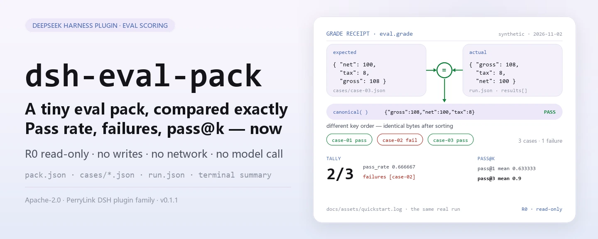
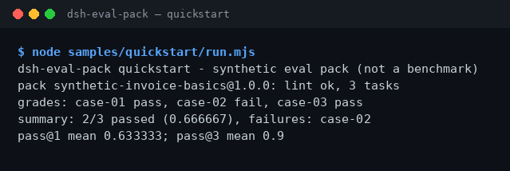

<div align="center">

<picture>
  <source media="(prefers-color-scheme: dark)" srcset="docs/assets/dsh-eval-pack-hero-en-dark.webp">
  
</picture>

# dsh-eval-pack

**छोटे इवैल पैक की हर केस को सटीक JSON समानता से मिलाएँ और वहीं पास दर, विफल id और pass@k पा लें।**

DeepSeek Harness के लिए पूरी तरह स्थानीय स्कोरिंग टूलकिट: पैक संरचना का lint, नियतात्मक JSON समानता स्कोरिंग, एक रन का सारांश और निष्पक्ष pass@k अनुमान — चारों टूल रीड-ओनली हैं, बिना नेटवर्क, बिना मॉडल कॉल और बिना अपलोड।

[इंस्टॉल](#तीन-चरणों-में-शुरुआत) · [कॉन्फ़िगरेशन](#कॉन्फ़िगरेशन) · [FAQ](#faq) · [简体中文](README.md) · [English](README.en.md) · [Español](README.es.md) · [Português](README.pt.md) · [हिन्दी](README.hi.md)

[](LICENSE)
[](#संगतता)
[](https://www.npmjs.com/package/dsh-eval-pack)
[](https://github.com/PerryLink/dsh-eval-pack/actions/workflows/ci.yml)
[](#संगतता)

[](https://github.com/PerryLink/dsh-eval-pack/stargazers)
[](https://www.npmjs.com/package/dsh-eval-pack)
[](https://dshfind.com/plugins/PerryLink/dsh-eval-pack?ref=badge)
[](https://dsh.market/)
[](https://gitee.com/perrylink/dsh-eval-pack)

```sh
dsh plugin --profile <profile> add dsh-eval-pack
```

</div>

<sub>सामुदायिक प्लगइन, DeepSeek से असंबद्ध। कैनोनिकल रिपॉज़िटरी: <https://github.com/PerryLink/dsh-eval-pack> (Gitee एक मिरर है)। स्थिति: alpha · केवल सार्वजनिक/सिंथेटिक डेटा से सत्यापित · GA नहीं — कोई ग्राहक डेटा या ग्राहक साक्ष्य नहीं, उत्पादन-तैयारी का दावा नहीं।</sub>

## यह क्या है

यह एक ही काम करता है: छोटे इवैल पैक की हर केस को सटीक JSON समानता से मिलाकर पास दर, विफल id और pass@k देता है। `eval_pack_lint` पहले पैक जाँचता है (`name`, `version`, अद्वितीय टास्क id), `eval_grade` कैनोनिकल JSON समानता से स्कोर करता है, `eval_summary` एक रन को पास दर और विफल सूची में बदलता है, और `eval_pass_at_k` से `1 - C(n-c, k) / C(n, k)` निष्पक्ष अनुमान निकालता है। चारों टूल शुद्ध फ़ंक्शन और पूरी तरह रीड-ओनली हैं: फ़ाइल नहीं लिखते, नेटवर्क नहीं उपयोग करते और मॉडल नहीं बुलाते; इनपुट सत्र पढ़कर टूलों को तर्क के रूप में देता है, मूल फ़ाइलें नहीं छूई जातीं।

- **किसके लिए उपयुक्त**: छोटे इवैल पैक (3–50 केस) की पास दर जाँचना, जहाँ नियतात्मक JSON समानता चाहिए और धुँधला मिलान स्वीकार्य नहीं।
- **किसके लिए नहीं**: मॉडल कॉल, व्यक्तिपरक स्कोरिंग या असली benchmark चाहिए ऐसे परिदृश्य — यह पैकेज केवल स्कोर और सारांश करता है; परीक्षणाधीन सिस्टम को कभी नहीं चलाता।

<picture>
  <source media="(prefers-color-scheme: dark)" srcset="docs/assets/dsh-eval-pack-flow-v5-dark.svg">
  
</picture>

## तीन चरणों में शुरुआत

1. **इंस्टॉल करें** (एक चैनल चुनें):

   ```sh
   # npm चैनल (अनुशंसित; प्रकाशित वर्ज़न)
   dsh plugin --profile <profile> add dsh-eval-pack
   # git चैनल (नवीनतम main; git+https://github.com/PerryLink/dsh-eval-pack.git के समतुल्य)
   dsh plugin --profile <profile> add github:PerryLink/dsh-eval-pack
   # tarball चैनल: इस रेपो में pnpm pack करके
   dsh plugin --profile <profile> add ./dsh-eval-pack-<version>.tgz
   ```

2. **न्यूनतम कॉन्फ़िगरेशन** (इंस्टॉल कमांड bundle patch पहले ही लागू कर देती है; हाथ से लिखे प्रोफ़ाइल यह एक पंक्ति चिपकाएँ):

   ```yaml
   - insert:
       - id: dsh-eval-pack
         name: dsh-eval-pack
   ```

   इस प्लगइन में कोई प्लगइन-स्तरीय कॉन्फ़िगरेशन कुंजी नहीं है; जो कुछ भी समायोज्य है वह टूल तर्कों में है — «कॉन्फ़िगरेशन» देखें।

3. **माउंट होने की पुष्टि करें**:

   ```sh
   dsh --profile <profile> --dump-config | grep dsh-eval-pack
   ```

   रेपो में सिंथेटिक सैंपल शामिल है। `lib/` बिल्ड आर्टिफ़ैक्ट है और वर्शन-नियंत्रित नहीं, इसलिए पहले बिल्ड करें (अंत में `quickstart ok` आना चाहिए):

   ```sh
   pnpm install --frozen-lockfile && pnpm build
   node samples/quickstart/run.mjs --check
   ```

   सत्र के अंदर सीधे कहना भी काफी है — डेमो प्रॉम्प्ट `package.json` के `dsh.demo.prompt` में प्रकाशित:

   ```text
   我用自带样例跑一次评测：3 个样本里过了几个、哪个没过、pass@3 是多少？
   ```

**अनइंस्टॉल**: `dsh plugin --profile <profile> remove dsh-eval-pack` (या प्रोफ़ाइल पैच से वह पंक्ति हटाएँ)।

<details>
<summary>DSH Desktop मार्केट से इंस्टॉल करें</summary>

सभी PerryLink प्लगइन DSH Desktop के अंतर्निहित मार्केट में ब्राउज़ किए जा सकते हैं: **Market → Sources → Add source → पेस्ट करें** `https://perrylink-dsh-catalog.perrylink.workers.dev/catalog-source.json` **→ चुनें**। इंस्टॉलेशन के लिए मार्केट की npm पहचान जाँच और आपकी पुष्टि आवश्यक रहती है।

</details>

## मुख्य क्षमताएँ

- **पैक संरचना lint** — `eval_pack_lint` `name`, `version`, रिक्त न होने वाला `tasks` और टास्क id की विशिष्टता जाँचता है और `ok` के साथ त्रुटि-कोड array लौटाता है; कोई मूल्यांकन नहीं चलाता।
- **नियतात्मक JSON स्कोरिंग** — `eval_grade` पहले दोनों पक्षों को कैनोनिकल बनाता है (ऑब्जेक्ट कुंजियाँ क्रमबद्ध, array अपने क्रम में) और फिर सीरियलाइज़ेशन की बाइट-दर-बाइट तुलना करता है: कुंजी क्रम से फ़र्क नहीं पड़ता, जबकि array क्रम, संख्या परिशुद्धता और स्ट्रिंग केस जैसे हैं वैसे ही तुलना होते हैं।
- **एक रन का सारांश** — `eval_summary` `total`, `passed`, `failed`, `pass_rate` (छह दशमलव) और विफल टास्क id देता है, उसी स्कोरिंग पैमाने से।
- **निष्पक्ष pass@k** — `eval_pass_at_k` BigInt से सटीक द्विपद गणना करके `1 - C(n-c, k) / C(n, k)` निकालता है और प्रति-टास्क `pass_at_k` तथा औसत लौटाता है; `k > samples` और `correct > samples` ठोस रूप से विफल होते हैं।
- **पूरी तरह स्थानीय, रीड-ओनली** — चारों टूल **R0** चिह्नित हैं: कोई फ़ाइल लेखन नहीं, कोई कॉन्फ़िगरेशन बदलाव नहीं, स्रोत में कोई HTTP / DNS / WebSocket कॉल नहीं और कोई मॉडल कॉल नहीं।

### टूल सतह

टूल नाम स्थिर API हैं; चारों टूल R0 रीड-ओनली हैं। नाम केवल ASCII अक्षर, अंक और अंडरस्कोर रखते हैं और provider के `tools[].name` नियम `^[a-zA-Z0-9_-]+$` से मेल खाते हैं।

| टूल | उद्देश्य | जोखिम |
|---|---|---|
| `eval_pack_lint` | `name` / `version` / रिक्त न होने वाला `tasks` और अद्वितीय टास्क id जाँचें | R0 रीड-ओनली |
| `eval_grade` | एक टास्क के लिए नियतात्मक JSON समानता स्कोर | R0 रीड-ओनली |
| `eval_summary` | एक रन का सारांश: पास संख्या, पास दर, विफल टास्क id | R0 रीड-ओनली |
| `eval_pass_at_k` | सैंपलिंग गणनाओं से निष्पक्ष pass@k और उसका औसत | R0 रीड-ओनली |

### इनपुट और आउटपुट

इनपुट:

- `pack.json`: `name`, `version` और `tasks` (टास्क id की सूची); `tasks` खाली नहीं हो सकता और हर id अद्वितीय होना चाहिए।
- हर केस के लिए एक JSON: `id`, `prompt`, `expected`; स्कोरिंग केवल `expected` और रन परिणाम के `actual` को देखती है।
- `run.json`: एक रन के परिणाम `results[].actual` में, तथा pass@k के लिए प्रयुक्त `sampling[]` प्रविष्टियाँ (`samples` / `correct`)।
- शामिल सैंपल `samples/quickstart/input/` में है: तीन केस JSON और एक रन परिणाम, कुल मिलाकर 500 KB से बहुत कम। आकार की कोई कठोर सीमा नहीं; एक JSON ≤1 MB रखें — सैंपल बस न्यूनतम पुनरुत्पाद्य सेट है।

आउटपुट:

- टर्मिनल सारांश: lint पास हुआ या नहीं, हर केस का pass/fail, विफल id के साथ पास दर, और pass@1 तथा pass@3।
- कोई फ़ाइल नहीं लिखी जाती; रिकॉर्ड चाहिए तो `--json` आउटपुट को अपनी फ़ाइल में रीडायरेक्ट करें।

### उदाहरण

quickstart सैंपल (सिंथेटिक, पैकेज के साथ; पहले `pnpm build`):

```sh
node samples/quickstart/run.mjs          # मानव-पठनीय सारांश
node samples/quickstart/run.mjs --json   # कैनोनिकल परिणाम — expected/result.json गोल्ड फ़ाइल का स्रोत
node samples/quickstart/run.mjs --check  # दोबारा गणना और गोल्ड से तुलना, अंत में quickstart ok
```

असली रन आउटपुट (`docs/assets/quickstart.log`, 2026-11-02 की रन):

```text
$ node samples/quickstart/run.mjs
dsh-eval-pack quickstart - synthetic eval pack (not a benchmark)
pack synthetic-invoice-basics@1.0.0: lint ok, 3 tasks
grades: case-01 pass, case-02 fail, case-03 pass
summary: 2/3 passed (0.666667), failures: case-02
pass@1 mean 0.633333; pass@3 mean 0.9
```



*सिंथेटिक सैंपल → गोल्ड फ़ाइल `samples/quickstart/expected/result.json`; कमांड, समय और आउटपुट हैश `screenshots.json` में हैं (`run_at` 2026-11-02T22:15:29+08:00, `output_sha256` `2ba7ea50…` से शुरू)।*

सार्वजनिक/सिंथेटिक स्वीकृति: `node scripts/acceptance.mjs` दोबारा चलाएँ; पंक्तियाँ `ACCEPTANCE.csv` में हैं (यहाँ `script` और `evidence_sha256` कॉलम छोड़े गए हैं):

| req_id | metric | threshold | actual | pass | source | counted |
|---|---|---|---|---|---|---|
| EVAL-A01 | valid pack accepted | 1/1 | true | true | public/synthetic | false |
| EVAL-A02 | duplicate task ids rejected | 1/1 | true | true | public/synthetic | false |
| EVAL-A03 | deterministic grade | 1/1 | true | true | public/synthetic | false |
| EVAL-A04 | canonical grading ignores key order | 1/1 | true | true | public/synthetic | false |
| EVAL-A05 | array order still matters | 1/1 | true | true | public/synthetic | false |
| EVAL-A06 | run summary pass rate | 1/1 | true | true | public/synthetic | false |
| EVAL-A07 | pass@k estimator | 1/1 | true | true | public/synthetic | false |
| PS1-QS01 | quickstart 样例与金标一致 | 1/1 | 1 | true | synthetic/quickstart | true |

*EVAL पंक्तियाँ सार्वजनिक/सिंथेटिक fixture जाँच हैं (`counted=false`); PS1-QS01 शामिल सैंपल की स्थानीय पुनरुत्पत्ति है (`counted=true`)। कोई भी ग्राहक रन नहीं है और कोई आउटपुट नहीं गढ़ा गया।*

## कॉन्फ़िगरेशन

इस प्लगइन में कोई Schemastery `Config` कुंजी नहीं है — `cordis.patch.yml` केवल एक पंक्ति `insert` करता है («तीन चरणों में शुरुआत» देखें), इसलिए ओवरराइड करने लायक कोई प्लगइन-स्तरीय कुंजी नहीं। जो कुछ भी समायोज्य है वह टूल तर्कों और इनपुट JSON फ़ील्ड में है:

| इनपुट | फ़ील्ड | अर्थ |
|---|---|---|
| `pack.json` | `name` / `version` / `tasks[].id` | पैक की पहचान और टास्क id सूची; `tasks` खाली नहीं हो सकता और id अद्वितीय होने चाहिए |
| `cases/<id>.json` | `id` / `prompt` / `expected` | हर केस का prompt और गोल्ड उत्तर; स्कोरिंग केवल `expected` और परिणाम के `actual` का उपयोग करती है |
| `run.json` | `results[].id` / `results[].actual` | एक रन के वास्तविक आउटपुट, `id` से केसों के साथ मिलान |
| `run.json` | `sampling[].task_id` / `samples` / `correct` | pass@k के लिए सैंपलिंग गणनाएँ; `0 ≤ correct ≤ samples` आवश्यक |

टूल तर्क (सभी अनिवार्य; अमान्य मान ठोस रूप से विफल होते हैं):

| तर्क | टूल | बाधा | अर्थ |
|---|---|---|---|
| `pack` | `eval_pack_lint` | एक JSON ऑब्जेक्ट | पूरा इवैल-पैक ऑब्जेक्ट |
| `actual` / `expected` | `eval_grade` | कोई भी JSON | कैनोनिकल तुलना के दोनों पक्ष |
| `results[]` | `eval_summary` | हर आइटम में `id` / `actual` / `expected` | एक रन के प्रति-केस परिणाम |
| `k` / `tasks[]` | `eval_pass_at_k` | `1 ≤ k ≤ samples`; `0 ≤ correct ≤ samples` | सैंपलिंग आँकड़े और pass@k का `k` |

> स्कोरिंग नियम: कुंजी क्रम से फ़र्क नहीं पड़ता, array क्रम से पड़ता है, और संख्याएँ पूरी तरह बराबर होनी चाहिए; `pass_rate` और `pass_at_k` दोनों छह दशमलव तक पूर्णांकित होते हैं (`0.666667`)।

## FAQ

<details>
<summary>इंस्टॉल न हो तो क्या करें?</summary>

DSH `>=0.2.1-rc.3 <0.4.0` और Node `>=24.9 <25` की पुष्टि करें, फिर नए `DSH_HOME` से पुनः प्रयास करें; पूरे चरण [TROUBLESHOOTING.md](TROUBLESHOOTING.md) में हैं।

</details>

<details>
<summary>दो JSON एक जैसे दिखते हैं, फिर केस विफल क्यों?</summary>

स्कोरिंग पहले कैनोनिकल बनाती है: ऑब्जेक्ट कुंजी क्रम से फ़र्क नहीं पड़ता, लेकिन array क्रम, संख्या परिशुद्धता और स्ट्रिंग केस जैसे हैं वैसे ही तुलना होते हैं — `12.34` और `12.35` बराबर नहीं, और `[1, 2]` तथा `[2, 1]` भी नहीं।

</details>

<details>
<summary>pass@k कैसे निकाला जाता है?</summary>

निष्पक्ष अनुमानक `1 - C(n-c, k) / C(n, k)` से, जहाँ `n` प्रति-टास्क सैंपल संख्या है और `c` सही सैंपलों की संख्या; द्विपद गणनाएँ BigInt से सटीक हैं। `k`, `n` से अधिक नहीं हो सकता और `correct`, `samples` से अधिक नहीं; अन्यथा कॉल `E_EVAL_K` / `E_EVAL_CORRECT` के साथ विफल होती है।

</details>

<details>
<summary>क्या यह मेरा असली इवैल सेट संभाल सकता है?</summary>

स्थानीय रूप से चलता है, लेकिन पैकेज alpha है और केवल सार्वजनिक/सिंथेटिक पैक से सत्यापित है — यह benchmark निष्कर्ष नहीं है। असली डेटा उपयोग से पहले अनाम करें और मानव समीक्षक रखें।

</details>

<details>
<summary>क्या यह नेटवर्क कॉल करता है या मॉडल बुलाता है?</summary>

नहीं। lint, स्कोरिंग और सारांश सब आपकी मशीन पर चलते हैं: चारों टूल शुद्ध फ़ंक्शन हैं, स्रोत में कोई HTTP / DNS / WebSocket कॉल नहीं है और कोई मॉडल नहीं बुलाया जाता।

</details>

## सुरक्षा सीमाएँ

- **रीड-ओनली।** चारों टूल केवल ऑब्जेक्ट लौटाते हैं: कोई फ़ाइल लेखन नहीं, कोई कॉन्फ़िगरेशन बदलाव नहीं, इनपुट JSON में कोई बदलाव नहीं। रिकॉर्ड चाहिए तो लौटाया गया मान या `--json` आउटपुट अपनी फ़ाइल में रीडायरेक्ट करें।
- **न नेटवर्क, न मॉडल कॉल।** जब तक कोई टूल स्पष्ट न कहे, नेटवर्क या मॉडल कॉल नहीं; `src/core/harness.ts` में केवल शुद्ध फ़ंक्शन हैं, और इनपुट-आउटपुट स्थानीय रहते हैं।
- **नियतात्मक स्कोरिंग।** कैनोनिकल सीरियलाइज़ेशन और बाइट-दर-बाइट तुलना: वही इनपुट हमेशा वही निर्णय देता है — कोई यादृच्छिकता नहीं, कोई मॉडल विचरण नहीं।
- **ठोस विफलताएँ।** अमान्य इनपुट (पैक में `name` / `version` नहीं, खाली `tasks`, डुप्लिकेट टास्क id, गैर-धनात्मक पूर्णांक सैंपल संख्या, `correct > samples`, `k > samples`) कॉल पर त्रुटि देता है, एकसमान प्रारूप में — एक पंक्ति का सरल संदेश, `E_XXX` कोड और अगला कदम। नौ कोडों के लक्षण/कारण/कार्रवाई [TROUBLESHOOTING.md](TROUBLESHOOTING.md) में हैं।
- **कोई runner नहीं।** केवल स्कोर और सारांश: न मॉडल कॉल, न benchmark रन, और परीक्षणाधीन सिस्टम के बारे में कोई अनुमान नहीं।

## अनुमतियाँ और डेटा

- **पढ़ता है**: आपके बताए इवैल-पैक JSON, केस JSON और रन-परिणाम JSON (सत्र द्वारा पढ़कर तर्क के रूप में दिए जाते हैं); कोई अन्य निर्देशिका नहीं।
- **लिखता है**: कुछ नहीं (चारों टूल रीड-ओनली हैं और कोई फ़ाइल नहीं लिखते)।
- **नेटवर्क**: नहीं (स्रोत में कोई HTTP / DNS / WebSocket कॉल नहीं)।
- **बाहरी सिस्टम**: कोई नहीं (न मॉडल कॉल, न इवैल प्लेटफ़ॉर्म से कनेक्शन, कोई अपलोड नहीं)।
- **डेटा सीमा**: केवल सार्वजनिक/सिंथेटिक सैंपल से सत्यापित; कोई ग्राहक डेटा या ग्राहक साक्ष्य नहीं।

## ज्ञात सीमाएँ

- **केवल सार्वजनिक/सिंथेटिक डेटा से सत्यापित।** `ACCEPTANCE.csv` में हर EVAL-A01…A07 पंक्ति `counted=false` है (सार्वजनिक/सिंथेटिक fixture); केवल PS1-QS01 शामिल सैंपल की स्थानीय पुनरुत्पत्ति है (`counted=true`)। कोई ग्राहक डेटा या ग्राहक साक्ष्य नहीं।
- **alpha / आंशिक / गिना नहीं गया / GA नहीं।** उत्पादन-तैयारी का दावा नहीं; benchmark निष्कर्ष नहीं।
- **केवल स्कोरिंग, रन नहीं।** न मॉडल कॉल, न असली मूल्यांकन रन, न व्यक्तिपरक स्कोरिंग, और सिस्टम के आउटपुट को न बनाना न सुधारना।
- **JSON समानता, शब्दार्थ समानता नहीं।** कुंजी क्रम अनदेखा होता है, लेकिन array क्रम, संख्या परिशुद्धता और स्ट्रिंग केस जैसे हैं वैसे ही तुलना होते हैं; शब्दार्थ तुलना अपने ही प्रवाह में करें।
- **pass@k सैंपलिंग डेटा पर निर्भर है।** `k` किसी टास्क के `samples` से अधिक नहीं हो सकता और `correct`, `samples` से अधिक नहीं; टास्कों के सैंपल अलग हों तो पहले न्यूनतम लें और एक ही `k` रखें।
- **इनपुट UTF-8 JSON होना चाहिए।** UTF-8 BOM होने पर पार्सर पहली कुंजी पर विफल होता है; BOM हटा दें।

## संगतता

| सतह | स्थिति |
|---|---|
| Harness | DeepSeek Harness `>=0.2.1-rc.3 <0.4.0` (`package.json` में `engines.dsh`) |
| Node | `>=24.9.0 <25` (`package.json` में `engines.node`) |
| प्लेटफ़ॉर्म | जहाँ भी DSH चले; केवल स्थानीय फ़ाइलें |
| डेटा | न नेटवर्क, न मॉडल कॉल, न अपलोड |

## इकोसिस्टम और गुणवत्ता

- [Gitee मिरर](https://gitee.com/perrylink/dsh-eval-pack) (सिंक मिरर; GitHub कैनोनिकल है)
- [dshfind प्लगइन पेज](https://dshfind.com/plugins/PerryLink/dsh-eval-pack) (इंस्टॉल और रैंकिंग)
- [DSH Market](https://dsh.market/) (सूचीबद्ध)
- **1024 स्टोर चैनल**: एक बार `npm i -g dsh1024`, फिर `dsh1024 plugin --profile <profile> add dsh-eval-pack` ([deepseek1024.com](https://deepseek1024.com) इंस्टॉल रैंकिंग में गिना जाता है)
- [डोमेन इंडेक्स](https://perrylink.github.io/dsh-plugins/) · [चेकर परिवार](https://perrylink.github.io/zh/checkers/) · [मेनलाइन परिवार](https://github.com/PerryLink/dsh-kit)
- [समस्या निवारण](TROUBLESHOOTING.md)

### संबंधित कार्य और चेकर

सिबलिंग पैकेज और परिवार इंडेक्स: [dsh-policy-ledger](https://github.com/PerryLink/dsh-policy-ledger) · [dsh-pim-lint](https://github.com/PerryLink/dsh-pim-lint)

प्रत्येक सहायक पैकेज स्वतंत्र है, अपनी टूल सतह और वर्ज़न के साथ; केवल वही इंस्टॉल करें जो चाहिए:

| पैकेज | क्यों प्रासंगिक है |
|---|---|
| [`dsh-score`](https://github.com/PerryLink/dsh-score) | स्कोरिंग और मूल्यांकन उपयोगिताएँ। |
| [`dsh-doublecheck`](https://github.com/PerryLink/dsh-doublecheck) | आवश्यकता / परीक्षण / विरोधी गुणवत्ता गेट। |
| [`dsh-test-drive`](https://github.com/PerryLink/dsh-test-drive) | टेस्ट-ड्राइविंग वर्कफ़्लो और CI जाँचें। |

## डेवलपमेंट

```sh
pnpm install --frozen-lockfile                             # node >=24.9 <25
pnpm build && pnpm lint && pnpm typecheck && pnpm test      # tsc बिल्ड + lint + 15 node --test केस
pnpm gate                                                   # स्वीकृति गेट: scripts/acceptance.mjs दोबारा चलाता है और ACCEPTANCE.csv पंक्ति आकार जाँचता है
node samples/quickstart/run.mjs --check                     # सिंथेटिक सैंपल, quickstart ok प्रिंट करना चाहिए
```

वर्तमान वर्ज़न `0.2.0` (`package.json` से मेल खाता है)। टेस्ट: `node --test test/*.test.mjs` सब हरे (6 टेस्ट फ़ाइलें, 15 केस; `pnpm test` पहले बिल्ड करता है)। `lib/` tsc का बिल्ड आउटपुट है और वर्जन-नियंत्रित नहीं (`.gitignore`), इसलिए सैंपल या टेस्ट से पहले `pnpm build` चलाएँ।

| निर्देशिका | सामग्री |
|---|---|
| `src/core/harness.ts` | lint / कैनोनिकलाइज़ेशन / स्कोरिंग / सारांश / pass@k के शुद्ध फ़ंक्शन, और नौ त्रुटि कोड |
| `src/plugin/` | Cordis प्लगइन प्रवेश (`inject: ['tools']`) और चारों टूलों की `defineTool` घोषणाएँ |
| `test/` | `node --test`: 6 फ़ाइलें, 15 केस |
| `samples/quickstart/` | सिंथेटिक इवैल पैक (3 केस + रन परिणाम + गोल्ड) और दोबारा चलाने योग्य `run.mjs` |
| `scripts/` | `acceptance.mjs` (स्वीकृति दोबारा), `gate.mjs` (गेट), `lint.mjs`, `check-npm-name.mjs`, `gen-readme-assets.py` (चित्र) |
| `docs/assets/` | हीरो बैनर (चार webp), संरचना चित्र (light/dark SVG जोड़ी) और असली रन स्क्रीनशॉट |

README की छवियाँ [`scripts/gen-readme-assets.py`](scripts/gen-readme-assets.py) से प्रोग्रामेटिक रूप से बनती हैं (Python: Pillow चार hero बैनर `hero-{zh,en}-{light,dark}.webp` बनाता है; `flow-v5-{light,dark}.svg` हाथ से लिखा संरचना चित्र है, light/dark, सभी पाँच भाषाओं में साझा) और दोबारा चलाई जा सकती हैं: `python scripts/gen-readme-assets.py`।

Topics: `deepseek-harness`, `dsh`, `dsh-plugin`, `eval`, `harness`, `perrylink`, `testing`

## परिवार और आभार

यह प्रोजेक्ट [PerryLink](https://github.com/PerryLink) के DeepSeek Harness प्लगइन परिवार का हिस्सा है (सभी Apache-2.0)। अगर यह उपयोगी लगे, तो **एक स्टार अगले व्यक्ति को इसे खोजने में मदद करता है** — इसके पीछे कुछ भी लॉक नहीं है।

- [@PerryLink](https://github.com/PerryLink) — निर्माता और रखरखावकर्ता: पैक lint / नियतात्मक स्कोरिंग / सारांश / pass@k का शुद्ध-फ़ंक्शन कोर, चारों `eval_*` टूल, quickstart सिंथेटिक सैंपल और स्वीकृति सूट, और पाँच-भाषा दस्तावेज़।

## लाइसेंस

[LICENSE](LICENSE) (Apache License 2.0) © 2026 PerryLink; `NOTICE` भी देखें।

<p align="center"><sub>Apache-2.0 · सामुदायिक प्लगइन, DeepSeek से असंबद्ध।</sub></p>
