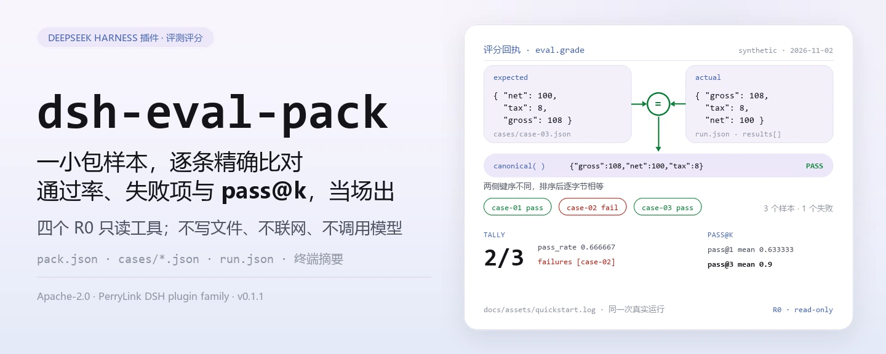
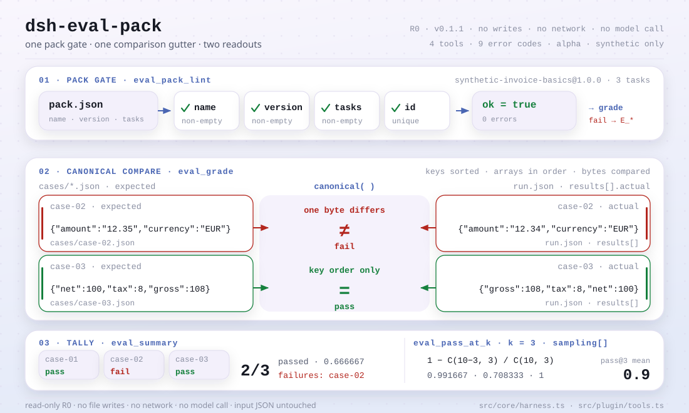

<div align="center">

<picture>
  <source media="(prefers-color-scheme: dark)" srcset="docs/assets/dsh-eval-pack-hero-zh-dark.webp">
  
</picture>

# dsh-eval-pack

**把一小包评测样本逐条按 JSON 精确比对，当场拿到通过率、失败项和 pass@k。**

面向 DeepSeek Harness 的纯本地评分工具：lint 评测包结构、确定性 JSON 相等评分、汇总一次运行、无偏 pass@k 估计——四个工具全部只读，不联网、不调用模型、不上传。

[安装](#三步上手) · [配置](#配置) · [FAQ](#faq) · [简体中文](README.md) · [English](README.en.md) · [Español](README.es.md) · [Português](README.pt.md) · [हिन्दी](README.hi.md)

[](LICENSE)
[](#兼容性)
[](https://www.npmjs.com/package/dsh-eval-pack)
[](https://github.com/PerryLink/dsh-eval-pack/actions/workflows/ci.yml)
[](#兼容性)

[](https://github.com/PerryLink/dsh-eval-pack/stargazers)
[](https://www.npmjs.com/package/dsh-eval-pack)
[](https://dshfind.com/plugins/PerryLink/dsh-eval-pack?ref=badge)
[](https://dsh.market/)
[](https://gitee.com/perrylink/dsh-eval-pack)

```sh
dsh plugin --profile <profile> add dsh-eval-pack
```

</div>

<sub>社区插件，与 DeepSeek 官方无关。唯一仓库：<https://github.com/PerryLink/dsh-eval-pack>（Gitee 为镜像）。状态：alpha · 仅用公开/合成数据验证 · 非 GA——不含客户数据或客户证据，不作生产可用声明。</sub>

## 它是什么

它只做一件事：把一小包评测样本逐条按 JSON 精确比对，给出通过率、失败项和 pass@k。`eval.pack_lint` 先检查包本身（`name`、`version`、任务 id 唯一性），`eval.grade` 做规范化 JSON 相等评分，`eval.summary` 把一次运行汇成通过率与失败清单，`eval.pass_at_k` 按无偏估计 `1 - C(n-c, k) / C(n, k)` 算采样通过率。四个工具都是纯函数、全部只读：不写文件、不联网、不调用模型；输入由会话读取后作为参数传入，原文件不动。

- **适合**：想复核一个小评测包（3–50 个样本）的通过率，需要确定性 JSON 相等评分、不接受模糊匹配的场景。
- **不适合**：需要调用模型、主观打分或跑真实 benchmark 的场景；本包只做评分与汇总，不运行被测对象。

<picture>
  <source media="(prefers-color-scheme: dark)" srcset="docs/assets/dsh-eval-pack-flow-v5-dark.svg">
  
</picture>

## 三步上手

1. **安装**（三选一）：

   ```sh
   # npm 通道（推荐，已发布版本）
   dsh plugin --profile <profile> add dsh-eval-pack
   # git 通道（最新 main；等价于 git+https://github.com/PerryLink/dsh-eval-pack.git）
   dsh plugin --profile <profile> add github:PerryLink/dsh-eval-pack
   # tarball 通道：本仓库 pnpm pack 后
   dsh plugin --profile <profile> add ./dsh-eval-pack-<version>.tgz
   ```

2. **最小配置**（安装命令已自动应用 bundle patch；手写 profile 时照抄这一行即可）：

   ```yaml
   - insert:
       - id: dsh-eval-pack
         name: dsh-eval-pack
   ```

   本插件没有任何插件级配置键；可调的东西全在工具参数里，见「配置」。

3. **验证已生效**：

   ```sh
   dsh --profile <profile> --dump-config | grep dsh-eval-pack
   ```

   仓库自带合成样例。`lib/` 是构建产物、不入库，先构建再跑一次（结尾应打印 `quickstart ok`）：

   ```sh
   pnpm install --frozen-lockfile && pnpm build
   node samples/quickstart/run.mjs --check
   ```

   在会话里也可以直接说：

   > 我用自带样例跑一次评测：3 个样本里过了几个、哪个没过、pass@3 是多少？

**卸载**：`dsh plugin --profile <profile> remove dsh-eval-pack`（或从 profile patch 删掉该行）。

<details>
<summary>从 DSH Desktop 市场安装</summary>

所有 PerryLink 插件均可在 DSH Desktop 内置市场中浏览：**市场 → 来源 → 添加来源 → 粘贴** `https://perrylink-dsh-catalog.perrylink.workers.dev/catalog-source.json` **→ 选中**。安装仍需通过市场的 npm 身份校验与你的确认。

</details>

## 核心能力

- **包结构 lint** —— `eval.pack_lint` 检查 `name`、`version`、`tasks` 非空与任务 id 唯一，返回 `ok` 与错误码数组；不跑任何评测。
- **确定性 JSON 评分** —— `eval.grade` 先把两侧递归规范化成「对象键排序、数组保序」的稳定串，再逐字节比较：键顺序不影响结果，数组顺序、数字精度、字符串大小写都按原样比较。
- **一次运行汇总** —— `eval.summary` 给出 `total`、`passed`、`failed`、`pass_rate`（六位小数）与失败任务 id，用的是同一把评分尺子。
- **无偏 pass@k** —— `eval.pass_at_k` 按 `1 - C(n-c, k) / C(n, k)` 用 BigInt 精确组合数计算，返回逐任务 `pass_at_k` 与均值；`k > samples`、`correct > samples` 直接报错。
- **纯本地只读** —— 四个工具全部标 **R0**：不写文件、不改配置，源码里没有 HTTP / DNS / WebSocket 调用，也不调用模型。

### 工具面

工具名是稳定 API；四个工具全部 R0 只读。

| 工具 | 用途 | 风险 |
|---|---|---|
| `eval.pack_lint` | 校验评测包 `name` / `version` / `tasks` 非空与任务 id 唯一 | R0 只读 |
| `eval.grade` | 单个任务的确定性 JSON 相等评分 | R0 只读 |
| `eval.summary` | 汇总一次运行：通过数、通过率、失败任务 id | R0 只读 |
| `eval.pass_at_k` | 按采样数计算无偏 pass@k 与均值 | R0 只读 |

### 输入与输出

输入：

- `pack.json`：`name`、`version` 与 `tasks`（任务 id 列表）；`tasks` 不能为空、任务 id 必须唯一。
- 每个样本一个 JSON：`id`、`prompt`、`expected`；评分只看 `expected` 与运行结果里的 `actual`。
- `run.json`：一次运行的结果 `results[].actual`，以及 pass@k 用的 `sampling[]`（`samples` / `correct`）。
- 自带样例在 `samples/quickstart/input/`：3 个样本 JSON + 1 个 run 结果，合计远小于 500 KB。工具不设硬性大小上限，单个 JSON 建议 ≤1 MB，样例只是最小可复现集。

输出：

- 终端摘要：lint 是否通过、逐条 pass/fail、通过率与失败 id、pass@1 与 pass@3。
- 不写任何文件；需要留档时把 `--json` 的输出重定向到自己的文件即可。

### 示例

quickstart 样例（合成数据，随包发布；先 `pnpm build`）：

```sh
node samples/quickstart/run.mjs          # 人类可读摘要
node samples/quickstart/run.mjs --json   # 规范化结果 —— 金标 expected/result.json 的来源
node samples/quickstart/run.mjs --check  # 重算并与金标比对，结尾打印 quickstart ok
```

真实运行输出（`docs/assets/quickstart.log`，2026-11-02 实跑）：

```text
$ node samples/quickstart/run.mjs
dsh-eval-pack quickstart - synthetic eval pack (not a benchmark)
pack synthetic-invoice-basics@1.0.0: lint ok, 3 tasks
grades: case-01 pass, case-02 fail, case-03 pass
summary: 2/3 passed (0.666667), failures: case-02
pass@1 mean 0.633333; pass@3 mean 0.9
```


*合成样例 → 金标 `samples/quickstart/expected/result.json`；命令、时间与输出哈希见 `screenshots.json`（`run_at` 2026-11-02T22:15:29+08:00，`output_sha256` 以 `2ba7ea50…` 开头）。*

公开/合成验收：重跑 `node scripts/acceptance.mjs`，逐行明细在 `ACCEPTANCE.csv`（此处省略 `script` 与 `evidence_sha256` 两列）：

| req_id | metric | threshold | actual | pass | source | counted |
|---|---|---|---|---|---|---|
| EVAL-A01 | valid pack accepted | 1/1 | true | true | public/synthetic | false |
| EVAL-A02 | duplicate task ids rejected | 1/1 | true | true | public/synthetic | false |
| EVAL-A03 | deterministic grade | 1/1 | true | true | public/synthetic | false |
| EVAL-A04 | canonical grading ignores key order | 1/1 | true | true | public/synthetic | false |
| EVAL-A05 | array order still matters | 1/1 | true | true | public/synthetic | false |
| EVAL-A06 | run summary pass rate | 1/1 | true | true | public/synthetic | false |
| EVAL-A07 | pass@k estimator | 1/1 | true | true | public/synthetic | false |
| PS1-QS01 | quickstart 样例与金标一致 | 1/1 | 1 | true | synthetic/quickstart | true |

*EVAL 行全部是公开/合成 fixture 检查（`counted=false`）；PS1-QS01 是随包样例的本地复现（`counted=true`）。均非客户运行，没有虚构输出。*

## 配置

本插件没有 Schemastery `Config` 配置键——`cordis.patch.yml` 只 `insert` 一行（见「三步上手」），没有可覆盖的插件级配置项。可调的东西全在工具参数与输入 JSON 的字段里：

| 输入 | 字段 | 含义 |
|---|---|---|
| `pack.json` | `name` / `version` / `tasks[].id` | 评测包身份与任务 id 清单；`tasks` 不能为空、id 必须唯一 |
| `cases/<id>.json` | `id` / `prompt` / `expected` | 每个样本的 prompt 与金标；评分只看 `expected` 与运行结果里的 `actual` |
| `run.json` | `results[].id` / `results[].actual` | 一次运行的实际输出，按 `id` 与样本对齐 |
| `run.json` | `sampling[].task_id` / `samples` / `correct` | pass@k 的采样数与正确次数；要求 `0 ≤ correct ≤ samples` |

工具参数（全部必填，非法值直接报错）：

| 参数 | 工具 | 约束 | 含义 |
|---|---|---|---|
| `pack` | `eval.pack_lint` | 一个 JSON 对象 | 整个评测包对象 |
| `actual` / `expected` | `eval.grade` | 任意 JSON | 参与规范化比较的两侧 |
| `results[]` | `eval.summary` | 每项含 `id` / `actual` / `expected` | 一次运行的逐条结果 |
| `k` / `tasks[]` | `eval.pass_at_k` | `1 ≤ k ≤ samples`；`0 ≤ correct ≤ samples` | 采样统计与 pass@k 的 `k` |

> 评分规则：对象键顺序不影响结果，数组顺序会影响结果，数字必须完全相等；`pass_rate` 与 `pass_at_k` 都保留六位小数（`0.666667`）。

## FAQ

<details>
<summary>装不上怎么办？</summary>

确认 DSH `>=0.2.1-rc.3 <0.4.0`、Node `>=24.9 <25`，并用全新的 `DSH_HOME` 重试；完整步骤见 [TROUBLESHOOTING.md](TROUBLESHOOTING.md)。

</details>

<details>
<summary>为什么两份 JSON 看起来一样却没通过？</summary>

评分先做稳定序列化：对象的键顺序无所谓，但数组顺序、数字精度和字符串大小写都按原样比较；`12.34` 与 `12.35` 就是不相等，`[1, 2]` 与 `[2, 1]` 也是不相等。

</details>

<details>
<summary>pass@k 是怎么算的？</summary>

用无偏估计 `1 - C(n-c, k) / C(n, k)`，其中 `n` 是每个任务的采样数、`c` 是其中正确的次数；组合数用 BigInt 精确计算。`k` 不能超过 `n`，`correct` 不能超过 `samples`，否则直接报 `E_EVAL_K` / `E_EVAL_CORRECT`。

</details>

<details>
<summary>能处理我的真实评测集吗？</summary>

可以本地运行，但本包是 alpha、只用公开/合成评测包验证，不构成 benchmark 结论；真实评测集请先脱敏，并保留人工复核。

</details>

<details>
<summary>会联网或调用模型吗？</summary>

不会。lint、评分与汇总全部在本机完成：四个工具是纯函数，源码里没有 HTTP / DNS / WebSocket 调用，也不调用模型。

</details>

## 安全边界

- **只读。** 四个工具都只返回对象：不写文件、不改配置、不动输入 JSON。需要留档时，把返回值或 `--json` 输出重定向到你自己的文件。
- **不联网、不调用模型。** 除工具明确说明外，没有网络或模型调用；`src/core/harness.ts` 只有纯函数，输入输出都留在本地。
- **评分确定。** 稳定序列化 + 逐字节比较：同样的输入永远得到同样的结论，不存在随机性或模型方差。
- **失败响亮。** 非法输入（包缺 `name` / `version`、`tasks` 为空、任务 id 重复、采样数非正整数、`correct > samples`、`k > samples`）在调用时直接抛错，报错统一为 `<一句人话>（E_XXX）｜下一步：<动作>`；九个错误码的症状 / 原因 / 动作见 [TROUBLESHOOTING.md](TROUBLESHOOTING.md)。
- **不运行被测对象。** 没有 runner：本包只评分与汇总，不调用模型、不跑 benchmark、不对被测系统做任何假设。

## 权限与数据

- **读**：你指定的评测包 JSON、样本 JSON 与运行结果 JSON（由会话读取后作为参数传入）；不读其他目录。
- **写**：无（四个工具全部只读，不写任何文件）。
- **联网**：否（源码中没有 HTTP / DNS / WebSocket 调用）。
- **外部系统**：无（不调用模型、不连接评测平台、不上传数据）。
- **数据边界**：仅公开/合成样例验证；不含客户数据或客户证据。

## 已知限制

- **仅公开/合成数据验证。** `ACCEPTANCE.csv` 里 EVAL-A01…A07 全部 `counted=false`（公开/合成 fixture），只有 PS1-QS01 是随包样例的本地复现（`counted=true`）；不含客户数据或客户证据。
- **alpha / partial / not counted / 非 GA。** 不作生产可用声明，不构成 benchmark 结论。
- **只评分，不运行。** 没有 runner：不调用模型、不跑真实评测、不做主观打分，也不对被测对象的输出做任何生成或修补。
- **评分是 JSON 相等，不是语义相等。** 键顺序无关，但数组顺序、数字精度、字符串大小写都按原样比较；需要语义比对时请在你自己的流程里处理。
- **pass@k 依赖采样数据。** `k` 不能超过该任务的 `samples`，`correct` 不能超过 `samples`；不同任务采样数不同时，先取最小值再统一 `k`。
- **输入必须是 UTF-8 JSON。** 带 UTF-8 BOM 的文件会让解析器在第一个键上报错，去掉 BOM 即可。

## 兼容性

| 维度 | 状态 |
|---|---|
| Harness | DeepSeek Harness `>=0.2.1-rc.3 <0.4.0`（`package.json` 的 `engines.dsh`） |
| Node | `>=24.9.0 <25`（`package.json` 的 `engines.node`） |
| 平台 | 任何 DSH 可运行处；仅本地文件 |
| 数据 | 不联网、不调用模型、不上传 |

## 生态与质量

- [Gitee 镜像](https://gitee.com/perrylink/dsh-eval-pack)（同步镜像，以 GitHub 为准）
- [dshfind 插件页](https://dshfind.com/plugins/PerryLink/dsh-eval-pack)（安装量与排名）
- [DSH Market](https://dsh.market/)（已上架）
- **1024 商店渠道**：先 `npm i -g dsh1024`，再 `dsh1024 plugin --profile <profile> add dsh-eval-pack`（计入 [deepseek1024.com](https://deepseek1024.com) 安装排行）
- [领域索引](https://perrylink.github.io/dsh-plugins/) · [Checker 家族](https://perrylink.github.io/zh/checkers/) · [主线家族](https://github.com/PerryLink/dsh-kit)
- [故障排查](TROUBLESHOOTING.md)

### 相关项目与核查器

兄弟包与家族索引：[dsh-policy-ledger](https://github.com/PerryLink/dsh-policy-ledger) · [dsh-pim-lint](https://github.com/PerryLink/dsh-pim-lint)

每个配套包都是独立包、各有自己的工具面与版本，按需安装：

| 包 | 为何相关 |
|---|---|
| [`dsh-score`](https://github.com/PerryLink/dsh-score) | 评分与评测工具。 |
| [`dsh-doublecheck`](https://github.com/PerryLink/dsh-doublecheck) | 需求 / 测试 / 对抗性质量门禁。 |
| [`dsh-test-drive`](https://github.com/PerryLink/dsh-test-drive) | 试跑工作流与 CI 检查。 |

## 开发

```sh
pnpm install --frozen-lockfile                             # node >=24.9 <25
pnpm build && pnpm lint && pnpm typecheck && pnpm test      # tsc 构建 + lint + 14 个 node --test 用例
pnpm gate                                                   # 验收门禁：重跑 scripts/acceptance.mjs 并校验 ACCEPTANCE.csv 行形状
node samples/quickstart/run.mjs --check                     # 合成样例，结尾打印 quickstart ok
```

当前版本 `0.1.1`（与 `package.json` 一致）。测试：`node --test test/*.test.mjs` 全绿（5 个测试文件、14 个用例；`pnpm test` 已内置构建步骤）。`lib/` 是 tsc 构建产物、不入库（`.gitignore`），所以跑样例与测试前先 `pnpm build`。

| 目录 | 内容 |
|---|---|
| `src/core/harness.ts` | lint / 规范化 / 评分 / 汇总 / pass@k 的纯函数与九个错误码 |
| `src/plugin/` | Cordis 插件入口（`inject: ['tools']`）与四个工具的 `defineTool` 声明 |
| `test/` | `node --test`：5 个文件、14 个用例 |
| `samples/quickstart/` | 合成评测包（3 样本 + run 结果 + 金标）与可复跑的 `run.mjs` |
| `scripts/` | `acceptance.mjs`（验收复跑）、`gate.mjs`（门禁）、`lint.mjs`、`check-npm-name.mjs`、`gen-readme-assets.py`（配图） |
| `docs/assets/` | hero 横幅（四版 webp）、结构图（深/浅双版 SVG）与真实运行截图 |

配图由 [`scripts/gen-readme-assets.py`](scripts/gen-readme-assets.py) 程序化生成（Python：Pillow 绘制四版 hero 横幅 `hero-{zh,en}-{light,dark}.webp`；`flow-v5-{light,dark}.svg` 为手写 SVG 结构图，深/浅双版、五语共用），可重复执行：`python scripts/gen-readme-assets.py`。

Topics：`deepseek-harness`, `dsh`, `dsh-plugin`, `eval`, `harness`, `perrylink`, `testing`

## 家族与致谢

本项目是 [PerryLink](https://github.com/PerryLink) 维护的 DeepSeek Harness 插件家族成员（全部 Apache-2.0）。如果这个插件帮到了你，**给个 star**——它不解锁任何功能，但会让下一个人更容易找到它。

- [@PerryLink](https://github.com/PerryLink) —— 创建者与维护者：评测包 lint / 确定性评分 / 汇总 / pass@k 的纯函数核心、四个 `eval.*` 工具、quickstart 合成样例与验收套件、五语文档。

## License

[LICENSE](LICENSE)（Apache License 2.0）© 2026 PerryLink；另见 `NOTICE`。

<p align="center"><sub>Apache-2.0 · 社区插件，与 DeepSeek 无关。</sub></p>
