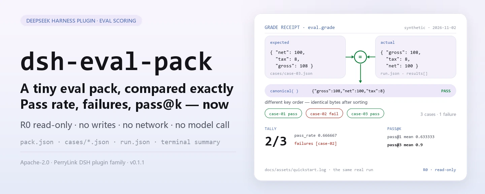

<div align="center">

<picture>
  <source media="(prefers-color-scheme: dark)" srcset="docs/assets/dsh-eval-pack-hero-en-dark.webp">
  
</picture>

# dsh-eval-pack

**Compare um pacote de avaliação pequeno caso a caso com igualdade JSON exata e receba na hora a taxa de aprovação, os ids com falha e o pass@k.**

Um conjunto de ferramentas de pontuação totalmente local para o DeepSeek Harness: lint da estrutura do pacote, nota determinística por igualdade JSON, resumo de uma execução e estimativa não enviesada de pass@k — as quatro ferramentas são somente leitura, sem rede, sem chamada a modelo e sem upload.

[Instalar](#instalação-em-três-passos) · [Configuração](#configuração) · [FAQ](#faq) · [简体中文](README.md) · [English](README.en.md) · [Español](README.es.md) · [Português](README.pt.md) · [हिन्दी](README.hi.md)

[](LICENSE)
[](#compatibilidade)
[](https://www.npmjs.com/package/dsh-eval-pack)
[](https://github.com/PerryLink/dsh-eval-pack/actions/workflows/ci.yml)
[](#compatibilidade)

[](https://github.com/PerryLink/dsh-eval-pack/stargazers)
[](https://www.npmjs.com/package/dsh-eval-pack)
[](https://dshfind.com/plugins/PerryLink/dsh-eval-pack?ref=badge)
[](https://dsh.market/)
[](https://gitee.com/perrylink/dsh-eval-pack)

```sh
dsh plugin --profile <profile> add dsh-eval-pack
```

</div>

<sub>Plugin da comunidade, não afiliado ao DeepSeek. Repositório canônico: <https://github.com/PerryLink/dsh-eval-pack> (o Gitee é um espelho). Estado: alpha · verificado apenas com dados públicos/sintéticos · não GA — sem dados ou evidências de clientes, sem promessa de produção.</sub>

## O que é

Ele faz uma coisa só: compara um pacote de avaliação pequeno caso a caso com igualdade JSON exata e devolve a taxa de aprovação, os ids com falha e o pass@k. `eval.pack_lint` confere o pacote (`name`, `version`, ids de tarefa únicos), `eval.grade` pontua por igualdade JSON canônica, `eval.summary` condensa uma execução em taxa de aprovação e lista de falhas, e `eval.pass_at_k` estima `1 - C(n-c, k) / C(n, k)`. As quatro ferramentas são funções puras e totalmente somente leitura: não gravam arquivos, não usam a rede e não chamam modelo; as entradas são lidas pela sessão e passadas como argumentos, e os arquivos originais não são tocados.

- **Adequado para**: revisar a taxa de aprovação de um pacote pequeno (3–50 casos) em que se exige igualdade JSON determinística e não se aceita correspondência difusa.
- **Não adequado para**: cenários que exigem chamada a modelo, pontuação subjetiva ou um benchmark real — este pacote só pontua e resume; nunca executa o sistema sob teste.

<picture>
  <source media="(prefers-color-scheme: dark)" srcset="docs/assets/dsh-eval-pack-flow-v5-dark.svg">
  
</picture>

## Instalação em três passos

1. **Instalar** (escolha um canal):

   ```sh
   # canal npm (recomendado; versões publicadas)
   dsh plugin --profile <profile> add dsh-eval-pack
   # canal git (main mais recente; equivalente a git+https://github.com/PerryLink/dsh-eval-pack.git)
   dsh plugin --profile <profile> add github:PerryLink/dsh-eval-pack
   # canal tarball: pnpm pack neste repo, depois
   dsh plugin --profile <profile> add ./dsh-eval-pack-<version>.tgz
   ```

2. **Configuração mínima** (o comando de instalação já aplica o bundle patch; perfis escritos à mão colam esta única linha):

   ```yaml
   - insert:
       - id: dsh-eval-pack
         name: dsh-eval-pack
   ```

   O plugin não tem chaves de configuração próprias; tudo o que é ajustável está nos argumentos das ferramentas — ver «Configuração».

3. **Verificar se monta**:

   ```sh
   dsh --profile <profile> --dump-config | grep dsh-eval-pack
   ```

   O repo inclui uma amostra sintética. `lib/` é artefato de build e não é versionado, então compile primeiro (deve terminar com `quickstart ok`):

   ```sh
   pnpm install --frozen-lockfile && pnpm build
   node samples/quickstart/run.mjs --check
   ```

   Dentro de uma sessão também basta pedir — prompt de demonstração publicado em `package.json` como `dsh.demo.prompt`:

   ```text
   我用自带样例跑一次评测：3 个样本里过了几个、哪个没过、pass@3 是多少？
   ```

**Desinstalar**: `dsh plugin --profile <profile> remove dsh-eval-pack` (ou remova a linha do patch do perfil).

<details>
<summary>Instalar pelo mercado do DSH Desktop</summary>

Todos os plugins PerryLink estão no mercado embutido do DSH Desktop: **Market → Sources → Add source → cole** `https://perrylink-dsh-catalog.perrylink.workers.dev/catalog-source.json` **→ selecione**. A instalação continua exigindo a verificação de identidade npm do mercado e a sua confirmação.

</details>

## Capacidades principais

- **Lint da estrutura do pacote** — `eval.pack_lint` confere `name`, `version`, `tasks` não vazio e unicidade dos ids de tarefa, devolvendo `ok` mais um array de códigos de erro; não executa nenhuma avaliação.
- **Nota JSON determinística** — `eval.grade` primeiro canoniza os dois lados (chaves de objeto ordenadas, arrays na ordem original) e compara as serializações byte a byte: a ordem das chaves não importa, enquanto a ordem dos arrays, a precisão numérica e as maiúsculas das strings são comparadas como estão.
- **Resumo de uma execução** — `eval.summary` informa `total`, `passed`, `failed`, `pass_rate` (seis casas decimais) e os ids de tarefa com falha, usando a mesma régua de pontuação.
- **pass@k não enviesado** — `eval.pass_at_k` calcula `1 - C(n-c, k) / C(n, k)` com binomiais exatos via BigInt e devolve o `pass_at_k` por tarefa mais a média; `k > samples` e `correct > samples` falham em voz alta.
- **Totalmente local e somente leitura** — as quatro ferramentas são marcadas **R0**: sem gravação de arquivos, sem mudança de configuração, sem chamadas HTTP / DNS / WebSocket no código e sem chamada a modelo.

### Superfície de ferramentas

Os nomes das ferramentas são uma API estável; as quatro são R0 somente leitura.

| Ferramenta | Propósito | Risco |
|---|---|---|
| `eval.pack_lint` | Validar `name` / `version` / `tasks` não vazio e ids de tarefa únicos | R0 somente leitura |
| `eval.grade` | Nota determinística por igualdade JSON de uma tarefa | R0 somente leitura |
| `eval.summary` | Resumir uma execução: aprovados, taxa de aprovação, ids com falha | R0 somente leitura |
| `eval.pass_at_k` | pass@k não enviesado e sua média a partir das contagens de amostragem | R0 somente leitura |

### Entrada e saída

Entrada:

- `pack.json`: `name`, `version` e `tasks` (lista de ids de tarefa); `tasks` não pode estar vazio e cada id deve ser único.
- Um JSON por caso: `id`, `prompt`, `expected`; a nota olha apenas `expected` e o `actual` do resultado da execução.
- `run.json`: os resultados de uma execução em `results[].actual`, mais as entradas `sampling[]` (`samples` / `correct`) usadas pelo pass@k.
- A amostra incluída está em `samples/quickstart/input/`: três JSON de caso e um resultado de execução, muito abaixo de 500 KB no total. Não há limite rígido de tamanho; mantenha cada JSON ≤1 MB — a amostra é só o conjunto mínimo reproduzível.

Saída:

- Resumo no terminal: se o lint passou, o pass/fail de cada caso, a taxa de aprovação com os ids com falha, e pass@1 mais pass@3.
- Nenhum arquivo é gravado; quando precisar de registro, redirecione a saída de `--json` para um arquivo seu.

### Exemplos

A amostra de início rápido (sintética, incluída no pacote; rode `pnpm build` antes):

```sh
node samples/quickstart/run.mjs          # resumo legível
node samples/quickstart/run.mjs --json   # resultado canônico — origem do gabarito expected/result.json
node samples/quickstart/run.mjs --check  # recalcula e compara com o gabarito, termina com quickstart ok
```

Saída real da execução (`docs/assets/quickstart.log`, execução de 2026-11-02):

```text
$ node samples/quickstart/run.mjs
dsh-eval-pack quickstart - synthetic eval pack (not a benchmark)
pack synthetic-invoice-basics@1.0.0: lint ok, 3 tasks
grades: case-01 pass, case-02 fail, case-03 pass
summary: 2/3 passed (0.666667), failures: case-02
pass@1 mean 0.633333; pass@3 mean 0.9
```


*Amostra sintética → gabarito `samples/quickstart/expected/result.json`; o comando, o horário e os hashes de saída estão em `screenshots.json` (`run_at` 2026-11-02T22:15:29+08:00, `output_sha256` começando por `2ba7ea50…`).*

Aceitação pública/sintética: repita `node scripts/acceptance.mjs`; as linhas estão em `ACCEPTANCE.csv` (aqui as colunas `script` e `evidence_sha256` são omitidas):

| req_id | metric | threshold | actual | pass | source | counted |
|---|---|---|---|---|---|---|
| EVAL-A01 | valid pack accepted | 1/1 | true | true | public/synthetic | false |
| EVAL-A02 | duplicate task ids rejected | 1/1 | true | true | public/synthetic | false |
| EVAL-A03 | deterministic grade | 1/1 | true | true | public/synthetic | false |
| EVAL-A04 | canonical grading ignores key order | 1/1 | true | true | public/synthetic | false |
| EVAL-A05 | array order still matters | 1/1 | true | true | public/synthetic | false |
| EVAL-A06 | run summary pass rate | 1/1 | true | true | public/synthetic | false |
| EVAL-A07 | pass@k estimator | 1/1 | true | true | public/synthetic | false |
| PS1-QS01 | quickstart 样例与金标一致 | 1/1 | 1 | true | synthetic/quickstart | true |

*As linhas EVAL são verificações de fixture pública/sintética (`counted=false`); PS1-QS01 é uma reprodução local da amostra incluída (`counted=true`). Nenhuma é execução de cliente e nenhuma saída é inventada.*

## Configuração

Este plugin não tem chaves `Config` do Schemastery — `cordis.patch.yml` apenas `insert` de uma linha (ver «Instalação em três passos»), então não há chave de plugin para sobrescrever. Tudo o que é ajustável está nos argumentos das ferramentas e nos campos do JSON de entrada:

| Entrada | Campos | Significado |
|---|---|---|
| `pack.json` | `name` / `version` / `tasks[].id` | Identidade do pacote e lista de ids de tarefa; `tasks` não pode estar vazio e os ids devem ser únicos |
| `cases/<id>.json` | `id` / `prompt` / `expected` | Prompt e resposta gabarito de cada caso; a nota usa apenas `expected` e o `actual` do resultado |
| `run.json` | `results[].id` / `results[].actual` | Saídas reais de uma execução, alinhadas aos casos por `id` |
| `run.json` | `sampling[].task_id` / `samples` / `correct` | Contagens de amostragem para o pass@k; exige `0 ≤ correct ≤ samples` |

Argumentos das ferramentas (todos obrigatórios; valores inválidos falham em voz alta):

| Argumento | Ferramenta | Restrição | Significado |
|---|---|---|---|
| `pack` | `eval.pack_lint` | um objeto JSON | O objeto do pacote completo |
| `actual` / `expected` | `eval.grade` | qualquer JSON | Os dois lados da comparação canônica |
| `results[]` | `eval.summary` | cada item com `id` / `actual` / `expected` | Resultados por caso de uma execução |
| `k` / `tasks[]` | `eval.pass_at_k` | `1 ≤ k ≤ samples`; `0 ≤ correct ≤ samples` | Estatística de amostragem e o `k` do pass@k |

> Regra de pontuação: a ordem das chaves não importa, a dos arrays importa, e os números devem ser exatamente iguais; `pass_rate` e `pass_at_k` são arredondados em seis casas decimais (`0.666667`).

## FAQ

<details>
<summary>Não instala — e agora?</summary>

Confirme DSH `>=0.2.1-rc.3 <0.4.0` e Node `>=24.9 <25`, depois tente de novo com um `DSH_HOME` novo; os passos completos estão em [TROUBLESHOOTING.md](TROUBLESHOOTING.md).

</details>

<details>
<summary>Dois JSON parecem iguais, por que o caso falhou?</summary>

A nota canoniza primeiro: a ordem das chaves de objeto não importa, mas a ordem dos arrays, a precisão numérica e as maiúsculas das strings são comparadas como estão — `12.34` e `12.35` não são iguais, e `[1, 2]` e `[2, 1]` também não.

</details>

<details>
<summary>Como o pass@k é calculado?</summary>

Pelo estimador não enviesado `1 - C(n-c, k) / C(n, k)`, em que `n` é o número de amostras por tarefa e `c` o de amostras corretas; os binomiais são exatos via BigInt. `k` não pode passar de `n` e `correct` não pode passar de `samples`; caso contrário a chamada falha com `E_EVAL_K` / `E_EVAL_CORRECT`.

</details>

<details>
<summary>Dá para processar meu conjunto de avaliação real?</summary>

Roda localmente, mas o pacote é alpha e verificado apenas com pacotes públicos/sintéticos — não é conclusão de benchmark. Anonimize os dados reais antes de usar e mantenha um revisor humano.

</details>

<details>
<summary>Faz chamadas de rede ou invoca um modelo?</summary>

Não. Lint, nota e resumo rodam na sua máquina: as quatro ferramentas são funções puras, o código não contém chamadas HTTP / DNS / WebSocket e nenhum modelo é chamado.

</details>

## Limites de segurança

- **Somente leitura.** As quatro ferramentas só devolvem objetos: não gravam arquivos, não mudam configuração e não alteram o JSON de entrada. Quando precisar de registro, redirecione o valor devolvido ou a saída de `--json` para um arquivo seu.
- **Sem rede, sem chamada a modelo.** A menos que uma ferramenta diga explicitamente, não há chamada de rede nem de modelo; `src/core/harness.ts` contém apenas funções puras, e a entrada e a saída ficam locais.
- **Nota determinística.** Serialização canônica mais comparação byte a byte: a mesma entrada sempre dá o mesmo veredicto — sem aleatoriedade nem variância de modelo.
- **Falhas em voz alta.** Entrada inválida (pacote sem `name` / `version`, `tasks` vazio, ids de tarefa duplicados, contagem de amostragem não inteira positiva, `correct > samples`, `k > samples`) lança erro na chamada, no formato uniforme `<o que aconteceu>（E_XXX）｜下一步：<ação>`. Os nove códigos, com sintoma/causa/ação, estão em [TROUBLESHOOTING.md](TROUBLESHOOTING.md).
- **Sem runner.** Apenas pontua e resume: sem chamada a modelo, sem rodar benchmark e sem suposições sobre o sistema sob teste.

## Permissões e dados

- **Lê**: o JSON do pacote, os JSON de caso e o JSON de resultado que você indicar (lidos pela sessão e passados como argumentos); nenhum outro diretório.
- **Escreve**: nada (as quatro ferramentas são somente leitura e não gravam arquivo algum).
- **Rede**: não (sem chamadas HTTP / DNS / WebSocket no código).
- **Sistemas externos**: nenhum (sem chamada a modelo, sem conexão a plataformas de avaliação, sem upload).
- **Fronteira de dados**: verificado apenas com amostras públicas/sintéticas; sem dados ou evidências de clientes.

## Limitações conhecidas

- **Verificado apenas com dados públicos/sintéticos.** Cada linha EVAL-A01…A07 em `ACCEPTANCE.csv` é `counted=false` (fixtures públicas/sintéticas); apenas PS1-QS01 é reprodução local da amostra incluída (`counted=true`). Sem dados ou evidências de clientes.
- **Alpha / parcial / não contabilizado / não GA.** Sem promessa de produção; não é conclusão de benchmark.
- **Só pontua, não executa.** Sem chamada a modelo, sem avaliação real, sem pontuação subjetiva e sem gerar ou corrigir a saída do sistema.
- **Igualdade JSON, não igualdade semântica.** A ordem das chaves é ignorada, mas a ordem dos arrays, a precisão numérica e as maiúsculas das strings são comparadas como estão; a comparação semântica fica no seu próprio fluxo.
- **pass@k depende dos dados de amostragem.** `k` não pode passar dos `samples` de uma tarefa e `correct` não pode passar de `samples`; quando as tarefas têm contagens diferentes, pegue o mínimo e use um `k` comum.
- **A entrada deve ser JSON UTF-8.** Um BOM UTF-8 faz o parser falhar na primeira chave; remova o BOM.

## Compatibilidade

| Superfície | Estado |
|---|---|
| Harness | DeepSeek Harness `>=0.2.1-rc.3 <0.4.0` (`engines.dsh` em `package.json`) |
| Node | `>=24.9.0 <25` (`engines.node` em `package.json`) |
| Plataformas | Onde o DSH rodar; apenas arquivos locais |
| Dados | Sem rede, sem chamada a modelo, sem upload |

## Ecossistema e qualidade

- [Espelho no Gitee](https://gitee.com/perrylink/dsh-eval-pack) (espelho sincronizado; o GitHub é o canônico)
- [Página do plugin no dshfind](https://dshfind.com/plugins/PerryLink/dsh-eval-pack) (instalações e ranking)
- [DSH Market](https://dsh.market/) (listado)
- **Canal da loja 1024**: `npm i -g dsh1024` uma vez, depois `dsh1024 plugin --profile <profile> add dsh-eval-pack` (conta no ranking de instalações do [deepseek1024.com](https://deepseek1024.com))
- [Índice de domínio](https://perrylink.github.io/dsh-plugins/) · [Família de checkers](https://perrylink.github.io/zh/checkers/) · [Família principal](https://github.com/PerryLink/dsh-kit)
- [Solução de problemas](TROUBLESHOOTING.md)

### Trabalho relacionado e checkers

Pacotes irmãos e índices da família: [dsh-policy-ledger](https://github.com/PerryLink/dsh-policy-ledger) · [dsh-pim-lint](https://github.com/PerryLink/dsh-pim-lint)

Cada pacote complementar é independente, com sua própria superfície de ferramentas e versão; instale só os que precisar:

| Pacote | Por que é relevante |
|---|---|
| [`dsh-score`](https://github.com/PerryLink/dsh-score) | Utilitários de pontuação e avaliação. |
| [`dsh-doublecheck`](https://github.com/PerryLink/dsh-doublecheck) | Portão de qualidade de requisitos / testes / adversários. |
| [`dsh-test-drive`](https://github.com/PerryLink/dsh-test-drive) | Fluxos de teste e verificações de CI. |

## Desenvolvimento

```sh
pnpm install --frozen-lockfile                             # node >=24.9 <25
pnpm build && pnpm lint && pnpm typecheck && pnpm test      # build tsc + lint + 14 casos node --test
pnpm gate                                                   # portão de aceitação: repete scripts/acceptance.mjs e valida a forma das linhas de ACCEPTANCE.csv
node samples/quickstart/run.mjs --check                     # amostra sintética, deve imprimir quickstart ok
```

Versão atual `0.1.1` (coincide com `package.json`). Testes: `node --test test/*.test.mjs` tudo verde (5 arquivos de teste, 14 casos; `pnpm test` compila antes). `lib/` é a saída do tsc e não é versionada (`.gitignore`), então rode `pnpm build` antes da amostra ou dos testes.

| Diretório | Conteúdo |
|---|---|
| `src/core/harness.ts` | Funções puras de lint / canonização / nota / resumo / pass@k, mais os nove códigos de erro |
| `src/plugin/` | Entrada do plugin Cordis (`inject: ['tools']`) e as declarações `defineTool` das quatro ferramentas |
| `test/` | `node --test`: 5 arquivos, 14 casos |
| `samples/quickstart/` | Pacote sintético (3 casos + resultado de execução + gabarito) e o `run.mjs` repetível |
| `scripts/` | `acceptance.mjs` (repetição da aceitação), `gate.mjs` (portão), `lint.mjs`, `check-npm-name.mjs`, `gen-readme-assets.py` (imagens) |
| `docs/assets/` | Banners hero (quatro webp), o diagrama de estrutura (par SVG claro/escuro) e a captura real da execução |

As imagens do README são geradas programaticamente por [`scripts/gen-readme-assets.py`](scripts/gen-readme-assets.py) (Python: o Pillow desenha os quatro banners hero `hero-{zh,en}-{light,dark}.webp`; o diagrama `flow-v5-{light,dark}.svg` é SVG escrito à mão, claro/escuro, compartilhado pelos cinco idiomas) e podem ser repetidas: `python scripts/gen-readme-assets.py`.

Topics: `deepseek-harness`, `dsh`, `dsh-plugin`, `eval`, `harness`, `perrylink`, `testing`

## Família e agradecimentos

Este projeto faz parte da família de plugins do DeepSeek Harness do [PerryLink](https://github.com/PerryLink) (todos Apache-2.0). Se for útil, **uma estrela ajuda a próxima pessoa a encontrá-lo** — nada fica bloqueado por trás dela.

- [@PerryLink](https://github.com/PerryLink) — criador e mantenedor: o núcleo de funções puras para lint / nota determinística / resumo / pass@k, as quatro ferramentas `eval.*`, a amostra sintética quickstart e a suíte de aceitação, e a documentação em cinco idiomas.

## Licença

[LICENSE](LICENSE) (Apache License 2.0) © 2026 PerryLink; veja também `NOTICE`.

<p align="center"><sub>Apache-2.0 · Plugin da comunidade, não afiliado ao DeepSeek.</sub></p>
